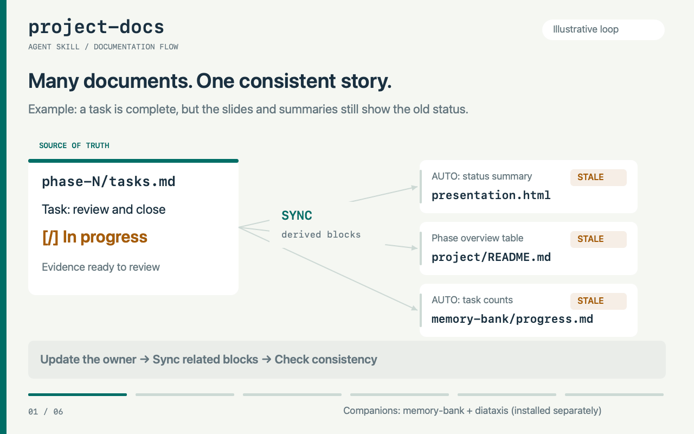
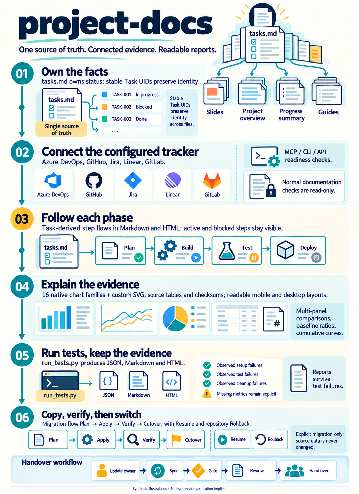

# project-docs

An agent skill that keeps a project's documentation true and consistent. Every fact has one owner file; derived pages are synced from it; a gate script refuses a docs change that leaves errors behind.

It works with Markdown and Excalidraw pages in `project/` (plan, phase tasks, presentations, results, issues, backlog) and `docs/` (tutorials, how-to, reference, explanation, sorted by Diátaxis).

## Visual overview

The English infographic covers configured integrations, phase flows, charts, test reports and explicit migration. The animated walkthrough shows an illustrative task closure: update the owner file, sync derived blocks, catch a remaining mismatch at the gate, fix it, and hand over with evidence. It is a simulated explanation, not a recording of a live project or a measured result. Narrative text still needs review.



<details>
<summary>Open the English infographic</summary>



</details>

[Infographic PNG](assets/project-docs/project-docs-infographic.png) · [Animated GIF](assets/project-docs/project-docs-workflow.gif) · [Still preview](assets/project-docs/project-docs-workflow-poster.png)

The infographic was created with ImageGen and checked against `SKILL.md` and `rules/tools.md`. The GIF uses original code-drawn graphics; rebuild it on macOS with `python3 assets/project-docs/build-gif.py` (requires Swift/AppKit and Pillow).

## Install

Download from `main` outside agent discovery folders, review it, then install the portable seven-skill bundle into one explicitly selected agent root. Keep source snapshots and backups for review/rollback. Examples below target Antigravity; select a different supported agent when that is your actual target. Download requires Git; the installer uses Python 3.9+ and its standard library.

### 1. Download from main

Use `main` as the installation source. You do not need to find or enter a commit SHA. The commands resolve `main` to a commit automatically and record the downloaded version, so activation uses the same code you reviewed even if `main` changes afterward.

| Toolkit MANIFEST setting | Value |
|---|---|
| Repository | `https://github.com/AtiwitchJ/skill-project-docs.git` |
| Branch / ref | `main` |
| Package | `project-docs` core plus six named workflow skills |
| Target | Explicit selected agent; use its native discovery root (table below) |

If a toolkit installer uses a MANIFEST, configure this repository URL and branch/ref `main` using its existing schema. This repository does not supply that installer's MANIFEST. The installer should record the resolved commit in its installation report. A manual SHA is optional when you specifically need an older version; do not leave an unresolved commit placeholder that causes installation to be skipped.

Run this in a terminal, outside an agent session that might load the downloaded skill:

```bash
(
  set -eu
  skill_repo='https://github.com/AtiwitchJ/skill-project-docs.git'
  skill_ref='main'
  skill_commit=$(git ls-remote --exit-code "$skill_repo" "refs/heads/$skill_ref" | cut -f1)
  test "${#skill_commit}" -eq 40
  case "$skill_commit" in *[!0-9a-f]*) exit 1 ;; esac
  skill_version="$HOME/.local/share/project-docs/versions/$skill_commit"
  mkdir -p "$HOME/.local/share/project-docs/versions"
  if [ ! -e "$skill_version" ] && [ ! -L "$skill_version" ]; then
    git clone --no-checkout "$skill_repo" "$skill_version"
    git -C "$skill_version" checkout --detach "$skill_commit"
  fi
  skill_version=$(cd "$skill_version" && pwd -P)
  test "$(git -C "$skill_version" rev-parse --show-toplevel)" = "$skill_version"
  test "$(git -C "$skill_version" rev-parse HEAD)" = "$skill_commit"
  test -z "$(git -C "$skill_version" status --porcelain --untracked-files=all)"
  test -f "$skill_version/SKILL.md"
  printf '%s\n' "$skill_commit" > "$HOME/.local/share/project-docs/candidate-commit"
  printf 'Downloaded %s at %s\nReview this folder: %s\n' "$skill_ref" "$skill_commit" "$skill_version"
)
```

An existing version folder is reused only if it is the expected clean Git checkout at that commit. If any command fails, stop and inspect that folder; do not delete it or overwrite it automatically. The commands resolve the version folder to its canonical path before verification.

### 2. Review before enabling

Review all bundled files, including `SKILL.md`, `scripts/`, `rules/`, `integrations/`, and templates. Check commands that write or delete files, access credentials, contact external services, or load other skills. Review the separately installed dependencies below as well. Do not run bundled scripts as part of this initial review.

The scripts use the Python standard library only (Python 3.9 or newer), except `qa_presentation.py`, which needs Playwright. Install that optional dependency in a separate Python virtual environment if you need presentation QA. Playwright is not required to install the skill or run its ordinary documentation checks.

### 3. Install the reviewed candidate for one agent

Close sessions for the selected agent before replacing installed skills. Run from a standalone terminal after review. The following reads the commit recorded during download; you do not need to type its SHA:

```bash
(
  set -eu
  skill_commit=$(cat "$HOME/.local/share/project-docs/candidate-commit")
  test "${#skill_commit}" -eq 40
  case "$skill_commit" in *[!0-9a-f]*) exit 1 ;; esac
  skill_version="$HOME/.local/share/project-docs/versions/$skill_commit"
  test "$(git -C "$skill_version" rev-parse HEAD)" = "$skill_commit"
  test -z "$(git -C "$skill_version" status --porcelain --untracked-files=all)"
  python3 "$skill_version/scripts/install_skills.py" --agent antigravity --dry-run
)
```

Review the selected/resolved root and all seven actions. Install using the same reviewed version:

```bash
(
  set -eu
  skill_commit=$(cat "$HOME/.local/share/project-docs/candidate-commit")
  test "${#skill_commit}" -eq 40
  case "$skill_commit" in *[!0-9a-f]*) exit 1 ;; esac
  skill_version="$HOME/.local/share/project-docs/versions/$skill_commit"
  test "$(git -C "$skill_version" rev-parse HEAD)" = "$skill_commit"
  test -z "$(git -C "$skill_version" status --porcelain --untracked-files=all)"
  python3 "$skill_version/scripts/install_skills.py" --agent antigravity --apply
)
```

For another target, replace `antigravity` in both commands with `codex`, `claude-code`, `gemini-cli`, `copilot`, `cursor`, `kilo`, `opencode` or `hermes`. For an existing installation, conflicts stop before changes. After reviewing those conflicts, add `--backup-existing` to both the plan and apply commands to move old entries intact outside discovery before replacing them. Real directories, ordinary files and dangling symlinks are preserved; a saved symlink does not copy/delete its target. Keep its target available for rollback. See [native roots, backup behavior and custom-root options](#install-the-six-workflows-for-your-agent).

No other agent root is automatically linked or updated. A root itself may be shared or resolve through a symlink: inspect the report. In particular, the Codex user root `~/.agents/skills` can also be read by other agents; `TARGET=self` cannot make that shared path private. Use an agent-specific root or a separately reviewed workspace configuration when strict isolation is required.

### 4. Verify installation and companion skills

The installer reports every skill name and writes the installed bundle digest/source provenance in `.project-docs-bundle.json` in the selected root. A second dry-run against the same reviewed source should show every package unchanged. Reload/restart the selected agent and confirm these seven entries: `project-docs`, `project-docs-setup`, `project-docs-check`, `project-docs-update`, `project-docs-rework`, `project-docs-close-phase` and `project-docs-test`. Confirm invocation in that agent; copying files alone does not verify UI execution.

`project-docs-sync` and `project-docs-now` are separate companions, not bundled or replaced here. Existing unknown-source copies remain untouched. The named workflows work directly through bundled rules/scripts without those companions. No companion installation source is prescribed by this repo; establish and review their actual source/version before relying on their automation.

### Update or roll back

Rerun download to resolve the current `main`, review/compare the new snapshot, then rerun the selected agent's installer with explicit intact backups for differing packages. Downloading does not activate a version; editing the source or an old shared symlink does not update native copies. Do not `git pull` inside a reviewed active source version or modify installed copies to hide drift. Record the branch/ref separately from the actual installed source/digest in your toolkit MANIFEST.

For manual rollback, close affected agent sessions, move the current seven bundle entries to a separate holding directory, then restore the original entries from the printed backup into the same selected root. Restore only entries that existed; leave originally absent paths absent. Restore the saved bundle manifest too when present. Keep unrelated skills untouched and do not recursively delete either the old installation or its backups. Verify discovery and restart the agent. If an install itself fails, the installer attempts to restore replaced entries automatically and reports any recovery issue and backup path.

References: [Git detached checkout](https://git-scm.com/docs/git-checkout), [Anthropic skill security guidance](https://platform.claude.com/docs/en/agents-and-tools/agent-skills/overview#security-considerations).

## Plugins and extensions across agents

The same seven-skill payload can be exported as native packages for **Claude Code, Codex, Antigravity, Copilot, Gemini CLI and Cursor**, plus an Agent Plugins 1.0 package and a portable-skills fallback. **Kilo, OpenCode and Hermes** use the portable installer; other skill hosts can use an explicit `--skills-dir`. This is a defined compatibility matrix, not a claim that all products accept one plugin manifest.

```bash
python3 scripts/build_plugins.py --all
```

The builder prints a versioned release directory under `dist/plugins/`. Open its `INSTALL.md` for actual host-specific import commands and its `build-manifest.json` for package/ZIP checksums. Native manifests and local catalogs are generated from the same source, rather than maintained as divergent rule copies. Rebuilding unchanged content is a no-op; changed content gets a new snapshot version. Existing modified exports are never overwritten. Use `--target antigravity` to export one format, `--version 1.0.0` for an explicitly versioned release, or `--check <printed-release-directory>` for read-only verification.

The export does **not** install/enable plugins, edit agent settings, configure accounts, register MCP servers, add automatic hooks or publish to a marketplace. Review and install only in the intended host. Plugin invocation can be namespaced, so use the host picker rather than assuming standalone slash names are unchanged. See the [compatibility, installation and verification guide](integrations/agent-packages.md).

## Everyday commands

The six workflows have portable [skill entry points](skills/) with their own `SKILL.md`, plus legacy Claude adapters in [commands/](commands/). Install the bundle below to make all six discoverable as named skills; they share one co-installed `project-docs` core instead of duplicating its rules.

| Command | Purpose | Example |
|---|---|---|
| `/project-docs-setup` | Create missing project documentation scaffold and entry points | `/project-docs-setup` |
| `/project-docs-check` | Read-only health, link, evidence and sync checks | `/project-docs-check phase 2` |
| `/project-docs-update` | Update local docs and paired outputs from authoritative facts | `/project-docs-update phase 2` |
| `/project-docs-rework` | Relocate misplaced artifacts, write missing docs and repair structure | `/project-docs-rework apply` |
| `/project-docs-close-phase` | Finalize evidence-backed phase summary, docs and indexes | `/project-docs-close-phase 2` |
| `/project-docs-test` | Run documented tests and generate reports, retaining failures | `/project-docs-test phase 2` |

Use the named skill in your agent’s selector or write `project-docs setup`, `project-docs check`, etc. in chat. The slash spelling is not universal across agents. These workflows are agent skills, not terminal executables. A phase argument on `test` does not invent a test mapping: the agent uses existing project guidance or asks when ambiguous. `setup` initializes the target project's docs; it does not install the skill. `update` works with bundled scripts and does not overwrite the separate `project-docs-sync` / `project-docs-now` companions. Detailed behavior is in [rules/commands.md](rules/commands.md).

### Install the six workflows for your agent

Run the installer from a reviewed source checkout/version folder. It installs **seven sibling folders**: `project-docs` plus the six named workflow skills. A wrapper installed alone with a generic skill-copy tool is incomplete; include its core or use this installer. The installer has no runtime dependency on Claude, Azure or another agent's skill folder.

```bash
# Read-only plan first; use the agent you actually want to configure.
python3 scripts/install_skills.py --agent antigravity --dry-run
# Install only into that agent's root.
python3 scripts/install_skills.py --agent antigravity --apply
```

| Target | User skill root |
|---|---|
| `antigravity` | `~/.gemini/config/skills/` |
| `codex` | `~/.agents/skills/` (shared; other readers of this root see changes too) |
| `claude-code` | `~/.claude/skills/` |
| `gemini-cli` | `~/.gemini/skills/` |
| `copilot` | `~/.copilot/skills/` |
| `cursor` | `~/.cursor/skills/` |
| `kilo` | `~/.kilo/skills/` (current documented location) |
| `opencode` | `~/.config/opencode/skills/` |
| `hermes` | `~/.hermes/skills/` |

These paths follow the official documentation for [Antigravity](https://antigravity.google/docs/skills?app=antigravity-ide), [Codex](https://learn.chatgpt.com/docs/build-skills), [Claude Code](https://code.claude.com/docs/en/skills), [Gemini CLI](https://geminicli.com/docs/cli/skills/) and [Copilot/VS Code](https://code.visualstudio.com/docs/agent-customization/agent-skills). Check your installed agent/version if its discovery settings differ. Additional roots follow [Cursor](https://cursor.com/docs/skills), [Kilo](https://kilo.ai/docs/customize/skills), [OpenCode](https://opencode.ai/v2/docs/skills) and [Hermes](https://github.com/NousResearch/hermes-agent/blob/main/website/docs/guides/work-with-skills.md). Older releases and customized home/XDG configurations may use other paths; use `--skills-dir` for their actual configured root rather than copying into a guessed folder. Custom/workspace roots can be selected explicitly:

```bash
python3 scripts/install_skills.py --skills-dir /path/to/workspace/.agents/skills --dry-run
python3 scripts/install_skills.py --skills-dir /path/to/workspace/.agents/skills --apply
```

The default is a read-only plan even without `--dry-run`. Existing identical packages are reused. Conflicts block the entire install before any entry is moved. To replace conflicting old entries after reviewing the plan, close affected agent sessions and explicitly request intact backups:

```bash
python3 scripts/install_skills.py --agent antigravity --backup-existing --dry-run
python3 scripts/install_skills.py --agent antigravity --backup-existing --apply
```

Backups default to `~/.local/share/skill-backups/project-docs-bundle/activation-*/`, outside discovery. A symlink is backed up as a link; its target is not deleted. Only the seven bundle names in the selected root are considered; unrelated skills and unknown-source sync/now companions are untouched. If that root resolves through a symlink, the report shows its resolved path; shared-root updates can affect other readers. The installer stages local copies, restores replaced entries if installation fails and records the bundle digest plus available source revision/dirty state in `.project-docs-bundle.json`. Check the printed backup path if recovery needs attention. Review/restore those saved entries with agents closed; never reset unrelated skills.

Updates are explicit snapshots: updating the repository or the old shared activation symlink does not update an installed native bundle. Review the new source, rerun this installer and use `--backup-existing` when replacing differing packages. You can also run the co-installed `project-docs/scripts/install_skills.py` from an existing bundle; it retains reinstall entry-point resources without nested discoverable `SKILL.md` files. Repository examples and visuals included with the core remain illustrative, not target-project evidence.

Reload/restart the selected agent and check for all six names in its skills selector. Antigravity and Claude Code support slash invocation; in Codex use the skill selector or explicit skill mention such as `$project-docs-check`. Other agents may expose a picker, activation tool or automatic selection instead of the same slash UI. Filesystem install success is not a claim that every agent UI was tested. Project-local skill names and multiple user roots can still shadow/duplicate one another; inspect those if a stale version appears.

Claude's old `commands/*.md` adapters remain available for existing installs; native skills take precedence over same-named command files according to [Claude's skill documentation](https://code.claude.com/docs/en/skills). This installer does not modify those command files, so review any older adapters separately. Prefer native skills for new installs rather than installing both forms. Use `--json` for an installation report suitable for your toolkit MANIFEST; keep the chosen branch/ref separate from the recorded installed snapshot/digest.

## Rework a disorganized project

Use `project-docs rework` in an agent with this skill loaded to organize scattered documents, resolve ownership, repair links/indexes and synchronize phase outputs. The default actually moves misplaced documents and their assets to the correct owner locations, writes missing required pages from available evidence, repairs links/specs/generator paths and verifies the result; `audit` only inspects and reports. This covers diagrams, images, reports, raw result data, attachments and other documentation artifacts, not only Excalidraw. It preserves original evidence, charts and Task identities. It does not rewrite product behavior, migrate remote records, commit or push. See [the rework workflow](rules/rework.md).

For example, a loose repository-root `architecture.excalidraw` moves to `project/diagrams/`, including when an old project rule recorded another location. Its links, spec and generator paths are repaired too. Missing phase summaries, indexes and applicable user guides are written from actual project records. Missing raw evidence is reported as a blocker rather than replaced with invented results. Every artifact and required missing file is accounted for in the rework report.

Install the portable bundle using [the everyday command instructions](#everyday-commands), then invoke the rework skill (slash notation on agents that support it):

```text
/project-docs-rework
/project-docs-rework audit
/project-docs-rework apply docs/
/project-docs-rework apply phase 2
```

For other agents, write `project-docs rework audit` or `project-docs rework apply phase 2` in chat. These are agent instructions, not terminal executables. A rework can run directly from bundled rules/scripts when the separate sync companions are unavailable. Apply mode records a report under `.project-docs/rework/<run-id>/report.md`; audit mode writes nothing. Missing evidence or unresolved factual conflicts are reported rather than silently marked complete.

## Phase flows and evidence presentations

Every phase can show its steps and current progress in both `tasks.md` and `presentation.html`. Status is derived from Task headers: all active and blocked steps remain visible, and verified task counts are not presented as estimates of effort or time. Optional grouping lives in `.project-docs/presentations/phase-N.json`; no status is duplicated there.

The HTML template adds reading/presentation modes, a slide index/counter, keyboard navigation, full screen, print/PDF styles and inspectable source-value tables. Charts are inline SVG and work offline. Selection follows the reader's question: bars compare categories, lines show ordered change, scatter plots show relationships, stacked bars show contributions, and heatmaps show categorical patterns. Every chart explains why it was chosen and names its source, units and limitations.

Custom charts use a project-owned SVG generator with source/generator checksums. The example includes a paired-dot chart, which keeps each scenario's before/after values together. Native renderers also cover distributions, uncertainty intervals, waterfalls and schedules. Use a justified custom generator for coordinated multi-panel compositions or encodings beyond the native contracts.

```bash
python3 /path/to/skill/scripts/sync_presentation.py 1
python3 /path/to/skill/scripts/sync_presentation.py --all --check
```

See the [HTML example](examples/phase-presentation/project/phases/phase-1/presentation.html), [paired Markdown flow and charts](examples/phase-presentation/project/phases/phase-1/tasks.md), and [chart selection/customization guide](rules/presentation-charts.md). The example contains **synthetic fixtures only**, not measured project performance. Rebuild an example in a new empty directory with `python3 scripts/build_presentation_demo.py --output /path/to/empty-directory`.

## Task categories and plan topics

Use category → exact plan topic → Task to retain plan traceability, with titles such as `2.6 [Agent with Azure MCP] Prepare Azure MCP` in Markdown and proposed tracker titles. Preserve existing numbers, Task UIDs and external mappings. Excluded/cancelled work stays visible and is not counted as delivered merely because it was excluded. See [task naming rules](rules/task-naming.md) and the [illustrative format](templates/task-grouping-example.md). These conventions do not authorize remote title/state changes or establish source-plan coverage without an actual mapping review. Whole-project/phase update and rework must show the actual hierarchy/title crosswalk and run `python3 /path/to/skill/scripts/task_naming.py --root . --require --json`. A missing topic registry is a blocker, not a hierarchy pass; see the [registry example](templates/task-topics.example.json). The general gate enforces the registry when present (or when `task_naming.required` is configured), while legacy unconfigured projects must use the explicit required check.

Task Descriptions also explain **why the work is needed, what it produces, who uses the result for which decision, and what evidence supports it**. [Wh-Question guidance](rules/task-descriptions.md) fits that meaning into the project’s approved headings/language order, with [a drafting worksheet](templates/task-description.md). New project scaffolds include scoped `AGENTS.md` instructions and a neutral ADO authoring-contract file; existing files are never overwritten. For older projects, merge the relevant instructions into the existing AGENTS/project guide. Explicit remote Description edits require current reads, a scoped change and readback; normal docs sync remains read-only.

## Integrations and migration

Choose the tracker in each project's config; installed tools do not choose it for you. Keep one primary tracker and add separate code/evidence connections.

| Integration | Reads and checks | Migration destination via direct API |
|---|---|---|
| Azure DevOps | Work items, comments, attachments, hierarchy | Work items, comments, files, parent links |
| GitHub | Issues, PR merge metadata, comments, sub-issues | Issues, comments and parent links; files need a capable bridge or an explicit archived-only limitation |
| Jira Cloud | Issues, workflow status, comments, attachments | Issues, transitions, comments, files and supported parent links |
| Linear | Issues, status, comments, linked attachments | Issues, comments, files and parent links |
| GitLab | Issues, MRs, notes and embedded uploads | Issues, notes and files; hierarchy is an explicit adapter limitation |
| GitHub Actions | Run/attempt/commit-bound test artifacts | Evidence source, not a tracker destination |

All 20 directed tracker pairs use the same migration engine. Actual features depend on the chosen transport's discovered capabilities and destination workflow. MCP is agent-operated; CLI requires a JSON bridge wrapper; direct APIs use Python standard-library HTTP clients. Normal docs checks are read-only externally; destination writes are restricted to explicit migration apply/resume operations.

Start with [provider configuration and bridge contract](integrations/providers.md), [Actions evidence](integrations/github-actions.md), or the [copy, verify, cutover and rollback guide](integrations/migration.md). Legacy ADO commands/config/Markdown mappings continue to work; `integrations.py upgrade` explicitly adds stable Task UIDs and shared mappings.

**Validation:** the offline suite exercises all 20 directions against a canonical simulated service and tests provider payloads, mocked API calls, CLI/MCP bridges, interruption recovery and artifact provenance. It does not prove live account permissions or full feature parity between providers. No real account data was migrated during development.

```bash
python3 -m unittest discover -s scripts -p test_integrations.py -v
```

## Dependencies

| Skill | Where it comes from | Why |
|---|---|---|
| `memory-bank` | install separately (upstream) | session context files under `memory-bank/`; this skill never edits it |
| `diataxis` | install separately (upstream) | the four-quadrant framework for `docs/`; this skill never edits it |
| `project-docs-sync` | separate skill, not in this repo | runs the sync flow (drift → change router → report) |
| `project-docs-now` | separate skill, not in this repo | the manual trigger of the same flow |

The skills share one rule: each has one job, and the change router (`rules/change-router.md`) is the only place that orders the work.

## Start a project

```bash
python3 ~/.agents/skills/project-docs/scripts/init_project.py --path <project folder> --name <name> --language Thai
```

This creates `.project-docs/` (config, rules, owner map, glossary, stale patterns, flow policy, diagram specs), `project/`, and the four `docs/` folders. It never overwrites an existing file.

Then fill in `.project-docs/rules.md` and `.project-docs/owner-map.md` for the project, and run the gate:

```bash
python3 ~/.agents/skills/project-docs/scripts/check_docs.py
```

Run the scripts from the project folder or any folder inside it. The project is found by its `.project-docs/config.json` (or `project/roadmap.md`).

## What is in the skill

```
SKILL.md              entry point: when to use it, the workflow, the definition of done
rules/                change router, writing rules, phases, flow, tools, diagrams
integrations/         tracker providers, Actions evidence, migration, Diátaxis, memory-bank
scripts/              the gate, sync scripts, drift check, diagram builder, tests
templates/            project scaffold, presentation template, diagram spec example
evals/evals.json      scenarios for checking that the skill behaves as its rules say
```

`rules/tools.md` lists every script and what it does.

## Diagrams

A picture can be built from a spec in `.project-docs/diagrams/`:

```bash
python3 ~/.agents/skills/project-docs/scripts/build_diagram.py .project-docs/diagrams/<name>.json --check
python3 ~/.agents/skills/project-docs/scripts/build_diagram.py .project-docs/diagrams/<name>.json
```

The builder checks the geometry before it writes: overlapping boxes, arrows that cross or pass through a box, text that does not fit, labels on top of boxes. The gate checks that each picture is exactly what its spec builds. See `rules/diagrams.md`.

## Complete result-report updates

“Update reports” includes **new graphics for new comparisons**, regeneration of affected existing charts, durable project-owned generators and matching report Markdown/HTML plus phase-slide embeddings. Historical charts remain tied to their own unchanged source runs; they do not cover a new result. Incomparable sample/method definitions must not be hidden in a performance ranking. See [the visual-completeness workflow](rules/result-visuals.md) and [registry example](templates/report-visuals.example.json).

`report_visuals.py --root . --require --json` checks registered source/asset/generator hashes and actual embeds, and flags unregistered numeric-table sections in its report scope. New scaffolds enable the gate policy; legacy projects use the explicit required check when adopting it. The checker does not prove statistical comparability, the truth of a table-only decision or visual readability; those reviews stay explicit. A generic passing gate alone is not permission to claim all report figures were updated.

## Test reports and readable charts

Use the [test-reporting guide](rules/test-reporting.md) to run tests and generate paired English Markdown/HTML, raw JSON, logs and failure workflows automatically:

```bash
python3 /path/to/skill/scripts/run_tests.py --root . --output project/results/tests/run-001 unittest --start-dir tests --pattern 'test_*.py'
```

For complex dashboards using multi-hop and Local/Workbench comparison patterns, use [advanced chart recipes](rules/advanced-chart-recipes.md): coordinated panels, step costs, cumulative curves, baseline ratios, environment comparisons and honest scaling. The design lessons are retained in the guide; the original SVG references were removed after review, and their benchmark JSON is not included.

There are **16 native chart families plus custom SVG charts**: comparison, series, trends, composition, relationships, matrices, distributions, intervals, paired changes, contributions and schedules. See the [interactive offline gallery](examples/chart-gallery/gallery.html), [Markdown gallery](examples/chart-gallery/gallery.md) and [selection rules](rules/presentation-charts.md). Reports select charts from actual available evidence; missing coverage/history stays explicit.

Examples: [intentional failure report](examples/test-report-fixture/verified/report.html) · [failure report Markdown](examples/test-report-fixture/verified/report.md) · [actual offline repository test report](examples/phase-presentation/project/results/tests/layout-verified/report.html).

HTML supports readable scrolling charts, vertical mobile workflows, responsive summaries, case search with pagination, source tables, print and visible error states. Test failures retain reports and their original nonzero exit code. Plain unittest commands outside this wrapper do not automatically create reports. Sample failure reports are intentionally failing fixtures, not production defects; integration tests use mocks, not live-service verification.

## Tests

```bash
cd <project folder>
python3 ~/.agents/skills/project-docs/scripts/test_build_diagram.py
```

The tests write only to temporary folders. To run the complete offline repository suite with reports, run `scripts/run_tests.py` from `examples/phase-presentation` and select `../../scripts` as `--start-dir`; the diagram tests require a documented project root.

## Limits

- The text-fit check estimates glyph width at 0.6 em per character. Thai and other wide scripts can be wider, so look at a picture before you trust it.
- The Azure DevOps check is read-only. It never writes to the backlog.
- The quadrant audit and the step-heading signals include Thai words, because the default language of the templates is Thai. Set the language in `.project-docs/config.json` and extend the signals for other languages.

## License

Not chosen yet.
# skill-project-docs

Editable diagram location checks are enabled by default: `/project-docs-check` reports an ERROR without moving files; `/project-docs-rework` moves misplaced originals and repairs references. Rework uses `scripts/diagram_locations.py --root <project> --plan --json`, then `--apply --json`, with intact backups outside the repository. It must review generator paths, rerun applicable generators/checks and repeat the location check; merely registering the old path in owner-map is insufficient. SVG/PNG previews may remain with their reader pages. Update the installed skill before expecting this new behavior.
