# Native chart gallery

Synthetic chart fixtures. No benchmark, confidence claim or real project schedule.

## Bar

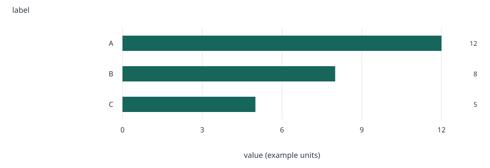

Aligned bars make category magnitudes easy to compare; the value axis includes zero.

Limits: Synthetic chart fixtures. No benchmark, confidence claim or real project schedule.

Source: [gallery-data.json](gallery-data.json) · `/categories`

| label | value |
| --- | --- |
| A | 12 |
| B | 8 |
| C | 5 |

## Line

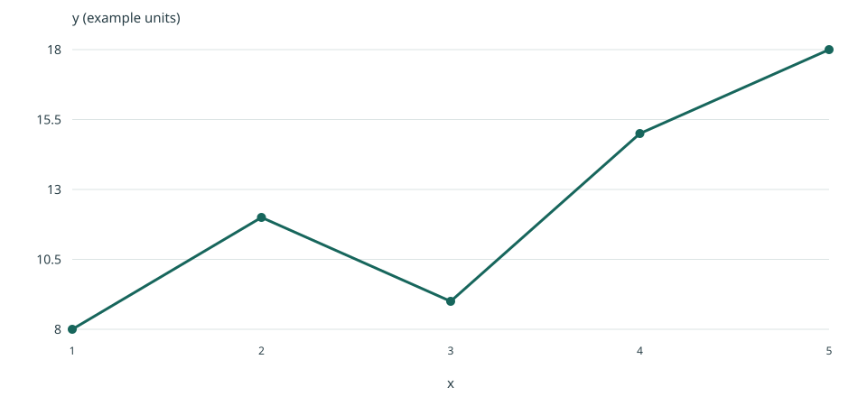

Connected observations show change over ordered numeric or date values; gaps must be explicit in the source.

Limits: Synthetic chart fixtures. No benchmark, confidence claim or real project schedule.

Source: [gallery-data.json](gallery-data.json) · `/ordered`

| x | y |
| --- | --- |
| 1 | 8 |
| 2 | 12 |
| 3 | 9 |
| 4 | 15 |
| 5 | 18 |

## Scatter

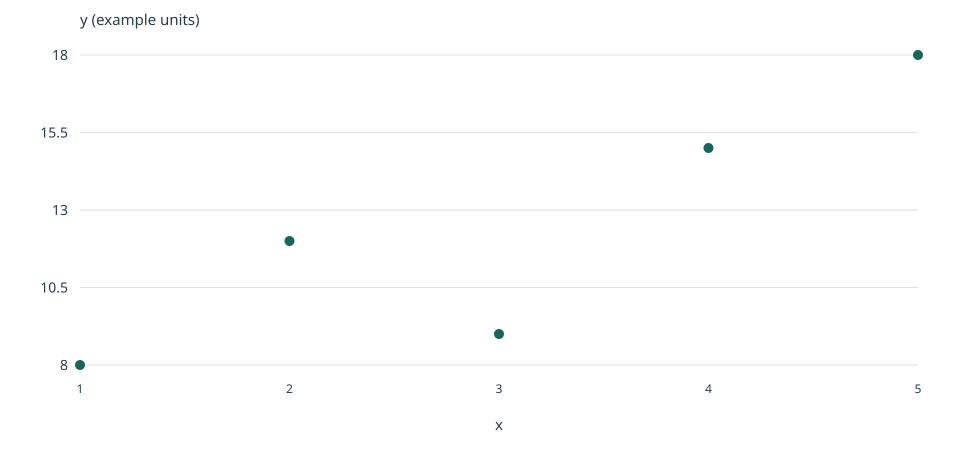

Point positions show association between two numeric measures; association does not establish causation.

Limits: Synthetic chart fixtures. No benchmark, confidence claim or real project schedule.

Source: [gallery-data.json](gallery-data.json) · `/ordered`

| x | y |
| --- | --- |
| 1 | 8 |
| 2 | 12 |
| 3 | 9 |
| 4 | 15 |
| 5 | 18 |

## Stacked Bar

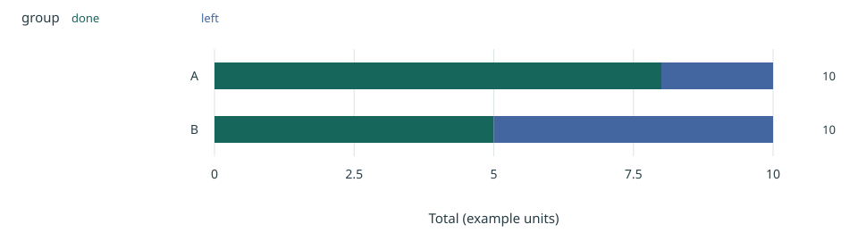

Segments show absolute contributions to a total; middle segments are harder to compare across groups.

Limits: Synthetic chart fixtures. No benchmark, confidence claim or real project schedule.

Source: [gallery-data.json](gallery-data.json) · `/parts`

| group | done | left |
| --- | --- | --- |
| A | 8 | 2 |
| B | 5 | 5 |

## Heatmap

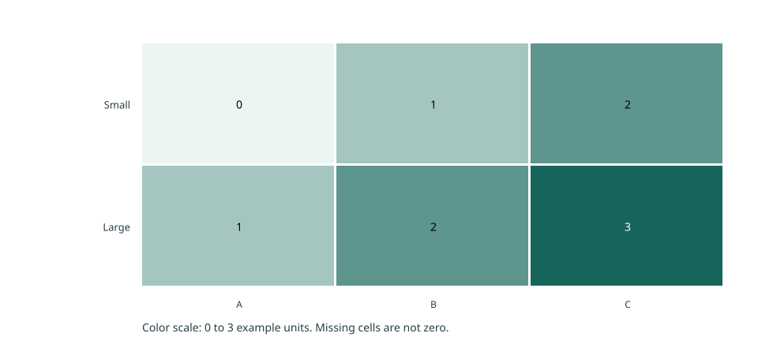

Cell color reveals patterns across two categories; use the values and table for exact comparisons.

Limits: Synthetic chart fixtures. No benchmark, confidence claim or real project schedule.

Source: [gallery-data.json](gallery-data.json) · `/matrix`

| x | y | value |
| --- | --- | --- |
| A | Small | 0 |
| A | Large | 1 |
| B | Small | 1 |
| B | Large | 2 |
| C | Small | 2 |
| C | Large | 3 |

## Grouped Bar

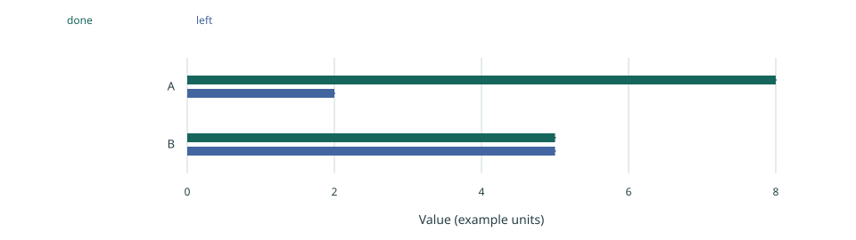

Side-by-side bars compare named series within categories on a common zero baseline and unit.

Limits: Synthetic chart fixtures. No benchmark, confidence claim or real project schedule.

Source: [gallery-data.json](gallery-data.json) · `/parts`

| group | done | left |
| --- | --- | --- |
| A | 8 | 2 |
| B | 5 | 5 |

## Multi Line

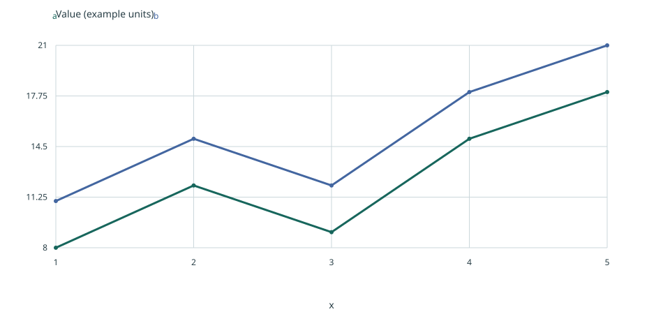

Separate lines compare series across the same ordered x values and unit; missing values are not interpolated.

Limits: Synthetic chart fixtures. No benchmark, confidence claim or real project schedule.

Source: [gallery-data.json](gallery-data.json) · `/ordered`

| x | a | b |
| --- | --- | --- |
| 1 | 8 | 11 |
| 2 | 12 | 15 |
| 3 | 9 | 12 |
| 4 | 15 | 18 |
| 5 | 18 | 21 |

## Area

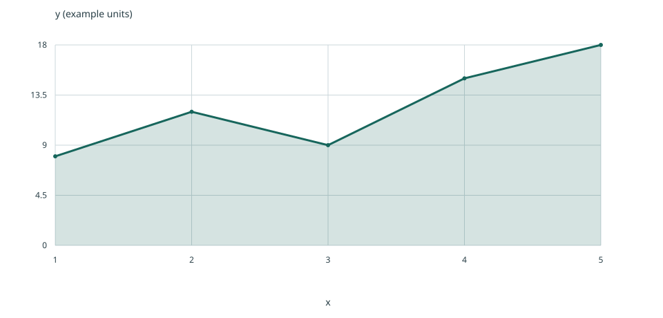

A zero-baseline filled area shows the magnitude of a nonnegative measure over ordered observations.

Limits: Synthetic chart fixtures. No benchmark, confidence claim or real project schedule.

Source: [gallery-data.json](gallery-data.json) · `/ordered`

| x | y |
| --- | --- |
| 1 | 8 |
| 2 | 12 |
| 3 | 9 |
| 4 | 15 |
| 5 | 18 |

## Histogram

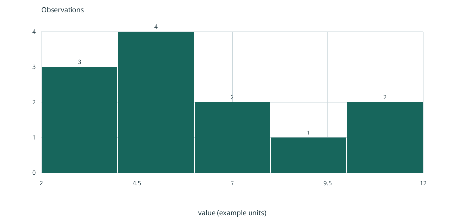

Explicit bins show the distribution of raw observations; bin choice affects the apparent shape.

Limits: Synthetic chart fixtures. No benchmark, confidence claim or real project schedule.

Source: [gallery-data.json](gallery-data.json) · `/samples`

| value |
| --- |
| 2 |
| 3 |
| 4 |
| 4 |
| 5 |
| 12 |
| 3 |
| 5 |
| 6 |
| 7 |
| 8 |
| 11 |

## Box

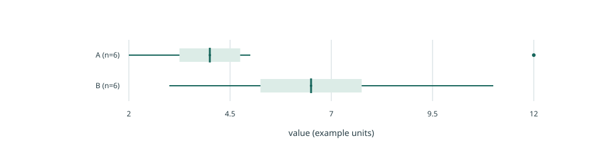

Boxes summarize raw sample distributions using linear-interpolated quartiles and Tukey 1.5-IQR whiskers; dots show outliers, not confidence intervals.

Limits: Synthetic chart fixtures. No benchmark, confidence claim or real project schedule.

Source: [gallery-data.json](gallery-data.json) · `/samples`

| group | value |
| --- | --- |
| A | 2 |
| A | 3 |
| A | 4 |
| A | 4 |
| A | 5 |
| A | 12 |
| B | 3 |
| B | 5 |
| B | 6 |
| B | 7 |
| B | 8 |
| B | 11 |

## Ecdf

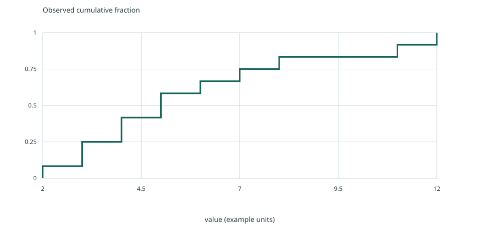

The empirical cumulative distribution shows the observed fraction at or below each value without selecting histogram bins.

Limits: Synthetic chart fixtures. No benchmark, confidence claim or real project schedule.

Source: [gallery-data.json](gallery-data.json) · `/samples`

| value |
| --- |
| 2 |
| 3 |
| 4 |
| 4 |
| 5 |
| 12 |
| 3 |
| 5 |
| 6 |
| 7 |
| 8 |
| 11 |

## Range

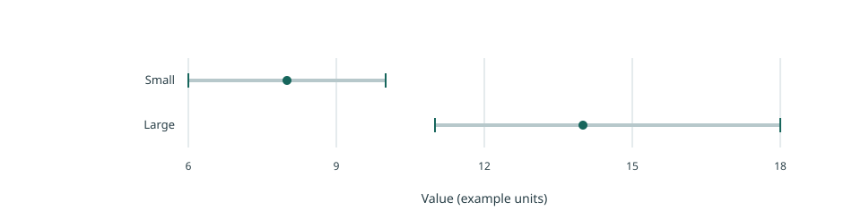

Supplied interval endpoints and optional estimates expose uncertainty or spread; their statistical meaning must be stated in the limits.

Limits: Synthetic chart fixtures. No benchmark, confidence claim or real project schedule.

Source: [gallery-data.json](gallery-data.json) · `/intervals`

| label | low | high | estimate |
| --- | --- | --- | --- |
| Small | 6 | 10 | 8 |
| Large | 11 | 18 | 14 |

## Dumbbell

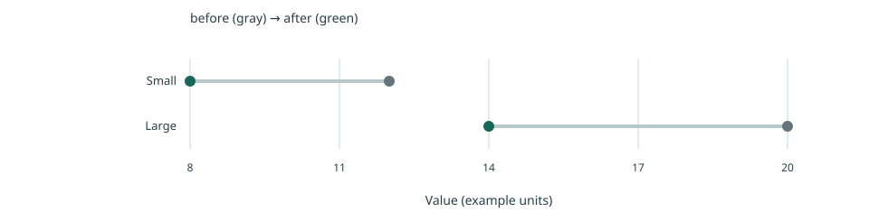

Linked points preserve the before/after pairing within each category without implying a time series.

Limits: Synthetic chart fixtures. No benchmark, confidence claim or real project schedule.

Source: [gallery-data.json](gallery-data.json) · `/intervals`

| label | before | after |
| --- | --- | --- |
| Small | 12 | 8 |
| Large | 20 | 14 |

## Waterfall

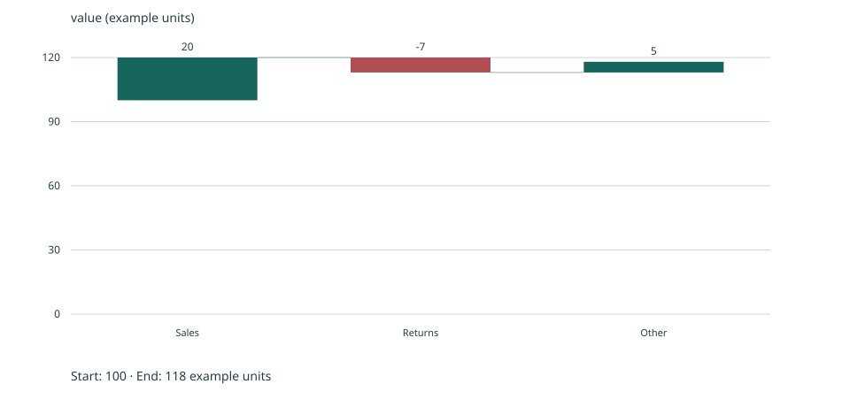

Signed contributions explain how a starting total changes; contributions must reconcile with any supplied final total.

Limits: Synthetic chart fixtures. No benchmark, confidence claim or real project schedule.

Source: [gallery-data.json](gallery-data.json) · `/contributions`

| label | value |
| --- | --- |
| Sales | 20 |
| Returns | -7 |
| Other | 5 |

## Timeline

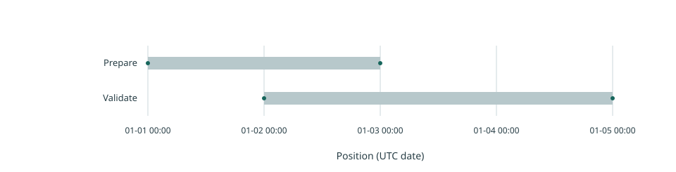

Intervals show supplied start/end positions or dates, including overlap; task counts never determine duration.

Limits: Synthetic chart fixtures. No benchmark, confidence claim or real project schedule.

Source: [gallery-data.json](gallery-data.json) · `/schedule`

| label | start | end |
| --- | --- | --- |
| Prepare | 2026-01-01T00:00:00Z | 2026-01-03T00:00:00Z |
| Validate | 2026-01-02T00:00:00Z | 2026-01-05T00:00:00Z |

## Pareto

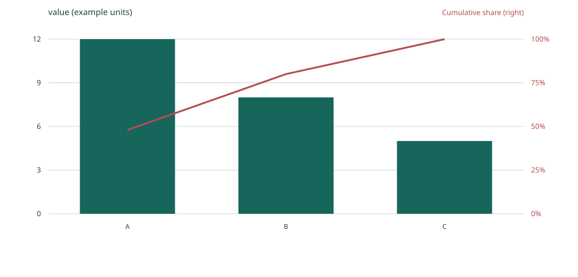

Descending nonnegative contributions and an explicitly labelled cumulative-share line show concentration; the two scales are kept distinct.

Limits: Synthetic chart fixtures. No benchmark, confidence claim or real project schedule.

Source: [gallery-data.json](gallery-data.json) · `/categories`

| label | value |
| --- | --- |
| A | 12 |
| B | 8 |
| C | 5 |
