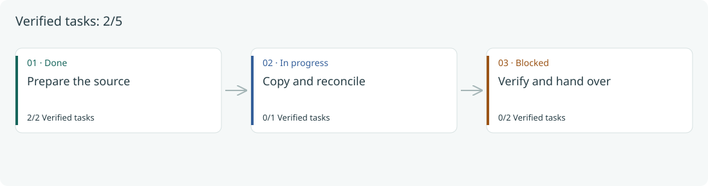
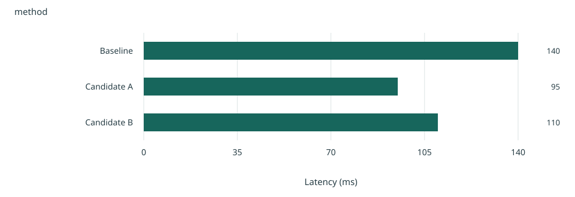
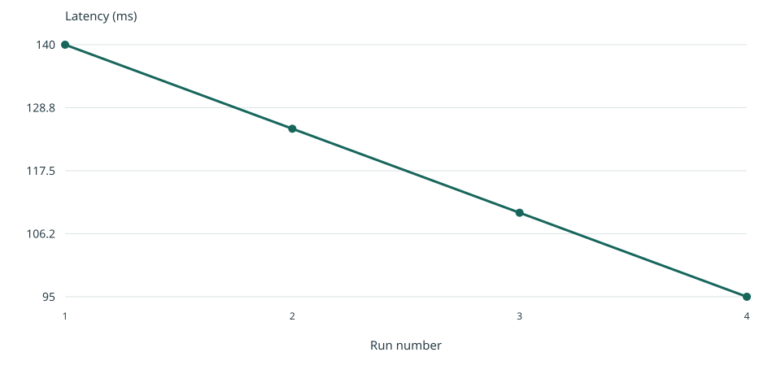
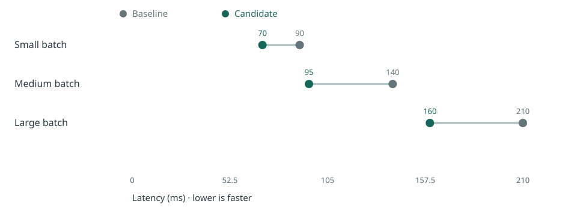

# PHASE 1: Follow the route, inspect the evidence

> **Period:** Illustrative fixture — no real delivery dates
> All tasks, blockers and measurements in this example are synthetic. They demonstrate the presentation system, not delivery results.

<!-- AUTO:phase-flow -->
## Phase route

Verified tasks: **2/5**. Counts describe verified tasks, not effort or elapsed time.

| Step | Status | Verified tasks | Tasks |
|---|---|---|---|
| 1. Prepare the source | Done | 2/2 | demo-owners, demo-connection |
| 2. Copy and reconcile | In progress | 0/1 | demo-copy |
| 3. Verify and hand over | Blocked | 0/2 | demo-verify, demo-handover |
<!-- /AUTO:phase-flow -->

<!-- AUTO:charts -->
## Evidence charts

### Chart: Compare categories on a common baseline

How do the example methods compare?

**Why this chart:** Aligned bars make category magnitudes easy to compare; the value axis includes zero.

- The zero baseline keeps category differences proportionate.

**Source:** [project/results/measurements.json](../../results/measurements.json) · JSON pointer `/comparison` · SHA-256 `bd9e8a9351bb8aae44723fd540dad7a12fd8323e8823fdc2f57cc5c196ba59ca`

**Limits:** Synthetic values, one illustrative observation per row; no statistical or production conclusion.

Source values

| method | latency_ms |
| --- | --- |
| Baseline | 140 |
| Candidate A | 95 |
| Candidate B | 110 |

### Chart: Use a line only when x has an order

How does the example value change across ordered runs?

**Why this chart:** Connected observations show change over ordered numeric or date values; gaps must be explicit in the source.

**Source:** [project/results/measurements.json](../../results/measurements.json) · JSON pointer `/trend` · SHA-256 `bd9e8a9351bb8aae44723fd540dad7a12fd8323e8823fdc2f57cc5c196ba59ca`

**Limits:** Synthetic values, one illustrative observation per row; no statistical or production conclusion.

Source values

| run | latency_ms |
| --- | --- |
| 1 | 140 |
| 2 | 125 |
| 3 | 110 |
| 4 | 95 |

### Chart: Keep each before/after pair together

How does the same scenario compare before and after?

**Why this chart:** A paired-dot chart preserves the before/after relationship for each scenario without implying a time series.

**Source:** [project/results/measurements.json](../../results/measurements.json) · JSON pointer `/paired` · SHA-256 `bd9e8a9351bb8aae44723fd540dad7a12fd8323e8823fdc2f57cc5c196ba59ca`

**Limits:** Synthetic values, one illustrative observation per row; no statistical or production conclusion.

Source values

| scenario | before_ms | after_ms |
| --- | --- | --- |
| Small batch | 90 | 70 |
| Medium batch | 140 | 95 |
| Large batch | 210 | 160 |

<!-- /AUTO:charts -->

### [x] 1.1 Define the owner files

**Task UID:** demo-owners
**Evidence:** Demonstration fixture; this is not an assertion about a live project.
- [x] Example owner map drafted.

### [x] 1.2 Choose the connection

**Task UID:** demo-connection
**Evidence:** Demonstration fixture only.
- [x] Example connection selected.

### [/] 1.3 Copy and reconcile

**Task UID:** demo-copy
- [x] Example inventory collected.
- [ ] Reconcile the remaining records.

### [!] 1.4 Verify representative cases (IMP-001)

**Task UID:** demo-verify
- [ ] Wait for the example validation owner (IMP-001).

### [ ] 1.5 Hand over the phase

**Task UID:** demo-handover
- [ ] Record the next decision and its evidence.
