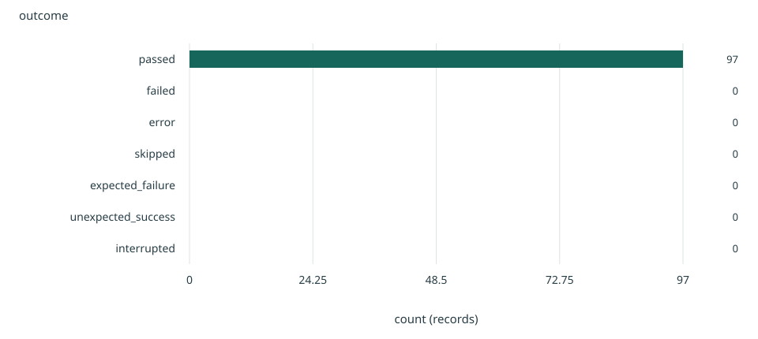
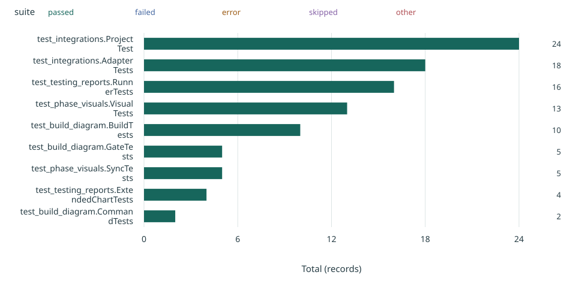
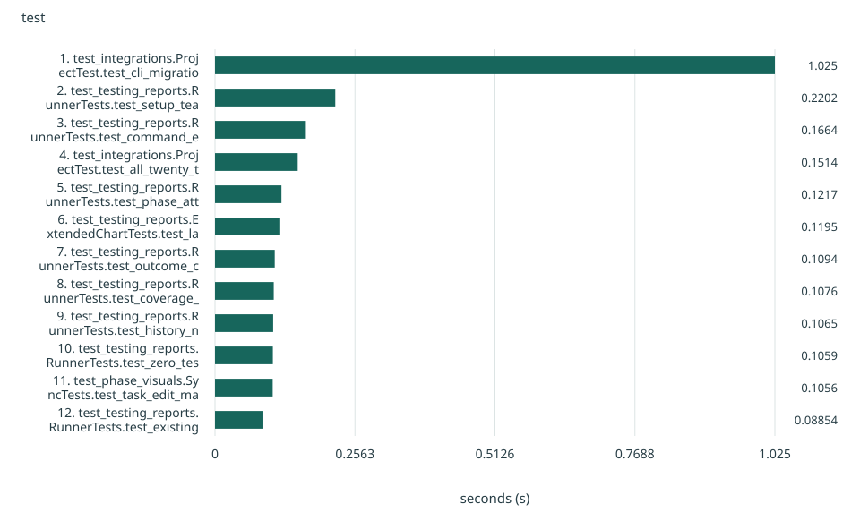
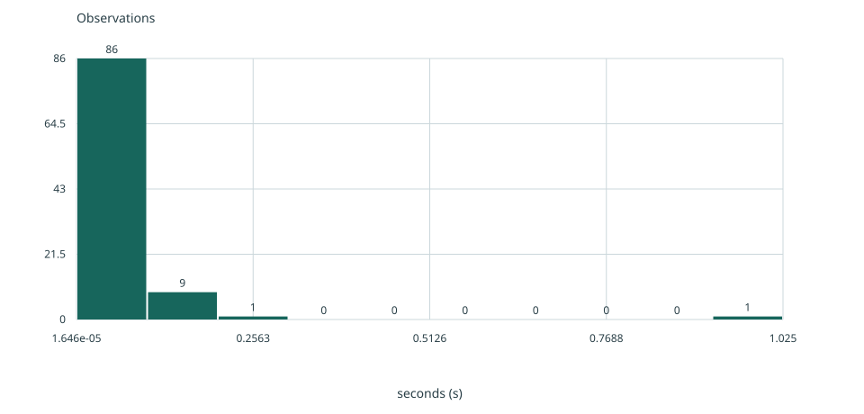
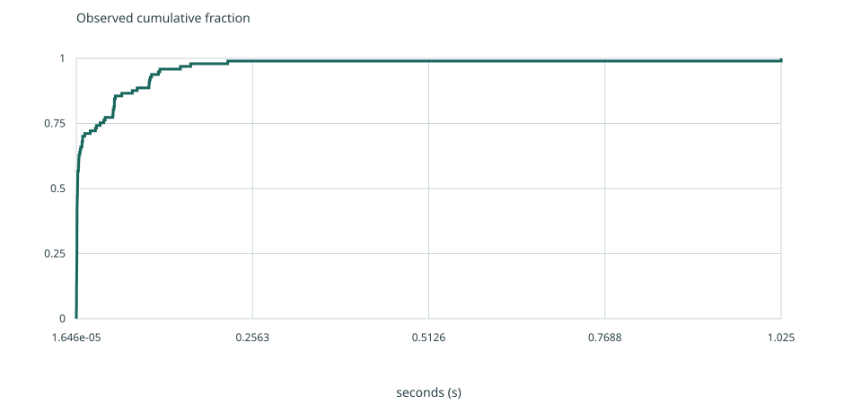
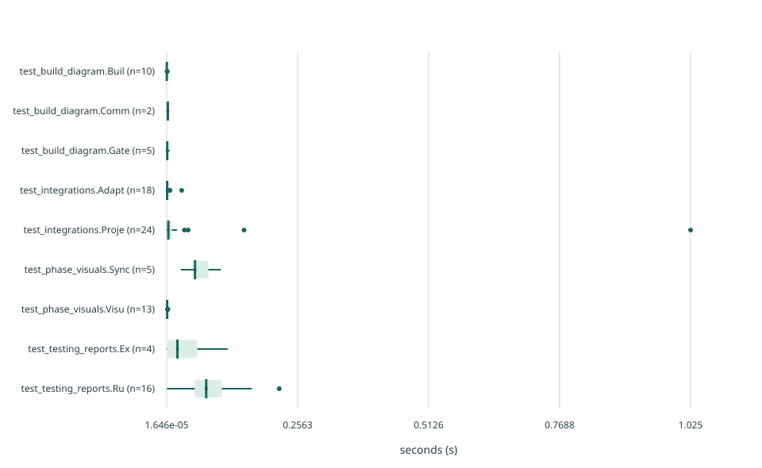
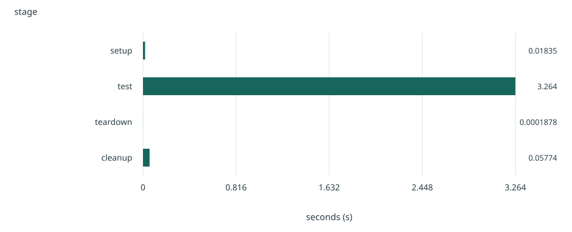

# Test run report

2026-10-26T12:48:32.212347+00:00

Offline repository suite. Real execution timings; integration services mocked. No live accounts.

**Run outcome:** PASSED · Exit code 0

**Inventory:** 97 test cases; 0 fixture records; 0 discovery records; 71 subtest observations.

passed / (passed + failed + error + unexpected_success) test cases; skipped and expected failures excluded

**Source:** [results.json](results.json) · SHA-256 `39f235ca9dc19fe6e36b5bff6bafcc177f75f795079cf806ad3e99ab8b6211bc`

## Available dimensions

| Dimension | Available | Meaning |
|---|---|---|
| Case outcomes | Available | Case-level records collected. |
| Duration and distribution | Available | 97 non-skipped cases have usable durations. Skipped cases are excluded; unknown durations are not replaced with zero. |
| Lifecycle timing | Available | Native instrumentation observed lifecycle calls. |
| Failure locations | Not available | No failure event recorded; this does not establish code coverage. |
| History trends | Not available | 1 comparable runs. Historical source paths and checksums are retained. |
| Flaky candidates | Not available | No repeated eligible case ID in a matching context; one run cannot establish instability. |
| Statement coverage | Not available | No coverage file supplied. Passing tests do not imply covered statements. |
| Branch coverage | Not available | Branch coverage was not supplied; statement coverage does not establish it. |

## Test and fixture outcomes

**Why:** Aligned bars make category magnitudes easy to compare; the value axis includes zero.

**Limits:** Observed test records only. Fixture/discovery records are identified separately. Timing is not a performance benchmark.

Source: [results.json](results.json) · `/datasets/outcomes`

| outcome | count |
| --- | --- |
| passed | 97 |
| failed | 0 |
| error | 0 |
| skipped | 0 |
| expected_failure | 0 |
| unexpected_success | 0 |
| interrupted | 0 |

## Outcomes by suite (minor suites explicitly grouped)

**Why:** Segments show absolute contributions to a total; middle segments are harder to compare across groups.

**Limits:** Observed test records only. Fixture/discovery records are identified separately. Timing is not a performance benchmark.

Source: [results.json](results.json) · `/datasets/suite-outcomes`

| suite | passed | failed | error | skipped | other |
| --- | --- | --- | --- | --- | --- |
| test_integrations.ProjectTest | 24 | 0 | 0 | 0 | 0 |
| test_integrations.AdapterTests | 18 | 0 | 0 | 0 | 0 |
| test_testing_reports.RunnerTests | 16 | 0 | 0 | 0 | 0 |
| test_phase_visuals.VisualTests | 13 | 0 | 0 | 0 | 0 |
| test_build_diagram.BuildTests | 10 | 0 | 0 | 0 | 0 |
| test_build_diagram.GateTests | 5 | 0 | 0 | 0 | 0 |
| test_phase_visuals.SyncTests | 5 | 0 | 0 | 0 | 0 |
| test_testing_reports.ExtendedChartTests | 4 | 0 | 0 | 0 | 0 |
| test_build_diagram.CommandTests | 2 | 0 | 0 | 0 | 0 |

## Slowest cases — top 12; full inventory below

**Why:** Aligned bars make category magnitudes easy to compare; the value axis includes zero.

**Limits:** Observed test records only. Fixture/discovery records are identified separately. Timing is not a performance benchmark.

Source: [results.json](results.json) · `/datasets/slowest`

| test | seconds |
| --- | --- |
| 1. test_integrations.ProjectTest.test_cli_migration_full_copy_uses_argv_json_contract | 1.025124792 |
| 2. test_testing_reports.RunnerTests.test_setup_teardown_cleanup_and_body_exception_are_distinguished | 0.22020833299999998 |
| 3. test_testing_reports.RunnerTests.test_command_exit_and_timeout_still_produce_reports_without_fake_cases | 0.16635708299999985 |
| 4. test_integrations.ProjectTest.test_all_twenty_tracker_directions_full_copy_and_readback | 0.15141916699999997 |
| 5. test_testing_reports.RunnerTests.test_phase_attachment_preserves_task_markers | 0.12165141700000026 |
| 6. test_testing_reports.ExtendedChartTests.test_large_inventory_keeps_all_records_with_bounded_table_previews | 0.11945395800000003 |
| 7. test_testing_reports.RunnerTests.test_outcome_changes_are_candidates_with_provenance_not_flaky_proof | 0.10937658299999997 |
| 8. test_testing_reports.RunnerTests.test_coverage_is_imported_and_absence_is_not_zero | 0.10755437500000031 |
| 9. test_testing_reports.RunnerTests.test_history_needs_repeated_matching_context | 0.10648733300000002 |
| 10. test_testing_reports.RunnerTests.test_zero_tests_and_malformed_junit_do_not_report_verified_pass | 0.10592341700000008 |
| 11. test_phase_visuals.SyncTests.test_task_edit_makes_both_flow_outputs_stale_and_sync_repairs | 0.1056291250000001 |
| 12. test_testing_reports.RunnerTests.test_existing_run_is_not_overwritten | 0.0885352079999997 |

## Distribution of observed case durations

**Why:** Explicit bins show the distribution of raw observations; bin choice affects the apparent shape.

**Limits:** Observed test records only. Fixture/discovery records are identified separately. Timing is not a performance benchmark.

Source: [results.json](results.json) · `/datasets/duration-distribution`

| seconds |
| --- |
| 0.00037774999999999614 |
| 0.00016025000000000067 |
| 0.0004681659999999921 |
| 0.0010857079999999908 |
| 0.0007762499999999922 |
| 0.00033350000000000046 |
| 0.0003180420000000045 |
| 0.0003199579999999952 |
| 0.00031733399999998857 |
| 0.0003086250000000068 |
| 0.0005509159999999985 |
| 0.003919667000000002 |
| 0.0009312910000000008 |
| 0.0030879580000000018 |
| 0.001107834000000002 |
| 0.0006334999999999952 |
| 0.005673666999999993 |
| 0.0049324999999999924 |
| 0.00020412499999999945 |
| 0.0010710000000000025 |
| 0.00026812499999999406 |
| 0.0013325000000000004 |
| 0.003743166000000006 |
| 0.0018839579999999911 |
| 0.02935379099999999 |
| 0.006514292000000005 |
| 0.0018217500000000109 |
| 0.0009231249999999969 |
| 3.6583000000006693e-05 |
| 0.0007839999999999792 |
| 0.0010931250000000003 |
| 1.6457999999996975e-05 |
| 0.0009103340000000126 |
| 0.0002334999999999976 |
| 2.4207999999997787e-05 |
| 0.008389792000000007 |
| 0.15141916699999997 |
| 0.0034056249999999677 |
| 0.0017762499999999792 |
| 0.009195750000000003 |
| 0.001983249999999992 |
| 1.025124792 |
| 0.0006329170000001216 |
| 0.009232416999999993 |
| 0.012325165999999887 |
| 0.0009751659999999163 |
| 0.0013022499999999493 |
| 0.008285083999999943 |
| 0.0005070419999999576 |
| 0.003424207999999984 |
| 0.03468679100000016 |
| 0.0017387499999999 |
| 0.0011255829999998745 |
| 0.0013724999999999987 |
| 0.0009582919999999717 |
| 0.020244083999999996 |
| 0.04196066700000012 |
| 0.0031071250000000994 |
| 0.002060874999999962 |
| 0.05536874999999997 |
| 0.05474079200000004 |
| 0.027799458999999915 |
| 0.081487584 |
| 0.1056291250000001 |
| 0.0020276669999998997 |
| 0.0015046249999999262 |
| 0.0021682499999999827 |
| 0.0009303750000000388 |
| 0.000708415999999934 |
| 0.0009105830000000203 |
| 0.0009510420000000686 |
| 0.001091500000000023 |
| 0.0008289580000000463 |
| 0.000921624999999926 |
| 0.0009811250000000271 |
| 0.000699749999999888 |
| 0.0007899170000000844 |
| 0.0021541249999998957 |
| 0.0010077920000000073 |
| 0.03999916699999995 |
| 0.11945395800000003 |
| 0.05313858299999974 |
| 0.066122542 |
| 0.16635708299999985 |
| 0.10755437500000031 |
| 0.05348041700000028 |
| 0.0885352079999997 |
| 0.05369424999999994 |
| 0.10648733300000002 |
| 0.0005637080000000516 |
| 0.05551141699999995 |
| 0.10937658299999997 |
| 0.12165141700000026 |
| 0.22020833299999998 |
| 0.05681787500000013 |
| 0.05535454099999981 |
| 0.10592341700000008 |

## Fraction of cases completed within each duration

**Why:** The empirical cumulative distribution shows the observed fraction at or below each value without selecting histogram bins.

**Limits:** Observed test records only. Fixture/discovery records are identified separately. Timing is not a performance benchmark.

Source: [results.json](results.json) · `/datasets/duration-ecdf`

| seconds |
| --- |
| 0.00037774999999999614 |
| 0.00016025000000000067 |
| 0.0004681659999999921 |
| 0.0010857079999999908 |
| 0.0007762499999999922 |
| 0.00033350000000000046 |
| 0.0003180420000000045 |
| 0.0003199579999999952 |
| 0.00031733399999998857 |
| 0.0003086250000000068 |
| 0.0005509159999999985 |
| 0.003919667000000002 |
| 0.0009312910000000008 |
| 0.0030879580000000018 |
| 0.001107834000000002 |
| 0.0006334999999999952 |
| 0.005673666999999993 |
| 0.0049324999999999924 |
| 0.00020412499999999945 |
| 0.0010710000000000025 |
| 0.00026812499999999406 |
| 0.0013325000000000004 |
| 0.003743166000000006 |
| 0.0018839579999999911 |
| 0.02935379099999999 |
| 0.006514292000000005 |
| 0.0018217500000000109 |
| 0.0009231249999999969 |
| 3.6583000000006693e-05 |
| 0.0007839999999999792 |
| 0.0010931250000000003 |
| 1.6457999999996975e-05 |
| 0.0009103340000000126 |
| 0.0002334999999999976 |
| 2.4207999999997787e-05 |
| 0.008389792000000007 |
| 0.15141916699999997 |
| 0.0034056249999999677 |
| 0.0017762499999999792 |
| 0.009195750000000003 |
| 0.001983249999999992 |
| 1.025124792 |
| 0.0006329170000001216 |
| 0.009232416999999993 |
| 0.012325165999999887 |
| 0.0009751659999999163 |
| 0.0013022499999999493 |
| 0.008285083999999943 |
| 0.0005070419999999576 |
| 0.003424207999999984 |
| 0.03468679100000016 |
| 0.0017387499999999 |
| 0.0011255829999998745 |
| 0.0013724999999999987 |
| 0.0009582919999999717 |
| 0.020244083999999996 |
| 0.04196066700000012 |
| 0.0031071250000000994 |
| 0.002060874999999962 |
| 0.05536874999999997 |
| 0.05474079200000004 |
| 0.027799458999999915 |
| 0.081487584 |
| 0.1056291250000001 |
| 0.0020276669999998997 |
| 0.0015046249999999262 |
| 0.0021682499999999827 |
| 0.0009303750000000388 |
| 0.000708415999999934 |
| 0.0009105830000000203 |
| 0.0009510420000000686 |
| 0.001091500000000023 |
| 0.0008289580000000463 |
| 0.000921624999999926 |
| 0.0009811250000000271 |
| 0.000699749999999888 |
| 0.0007899170000000844 |
| 0.0021541249999998957 |
| 0.0010077920000000073 |
| 0.03999916699999995 |
| 0.11945395800000003 |
| 0.05313858299999974 |
| 0.066122542 |
| 0.16635708299999985 |
| 0.10755437500000031 |
| 0.05348041700000028 |
| 0.0885352079999997 |
| 0.05369424999999994 |
| 0.10648733300000002 |
| 0.0005637080000000516 |
| 0.05551141699999995 |
| 0.10937658299999997 |
| 0.12165141700000026 |
| 0.22020833299999998 |
| 0.05681787500000013 |
| 0.05535454099999981 |
| 0.10592341700000008 |

## Duration spread across cases within each suite

**Why:** Boxes summarize raw sample distributions using linear-interpolated quartiles and Tukey 1.5-IQR whiskers; dots show outliers, not confidence intervals.

**Limits:** Observed test records only. Fixture/discovery records are identified separately. Timing is not a performance benchmark.

Source: [results.json](results.json) · `/datasets/suite-spread`

| suite | seconds |
| --- | --- |
| test_build_diagram.BuildTests | 0.00037774999999999614 |
| test_build_diagram.BuildTests | 0.00016025000000000067 |
| test_build_diagram.BuildTests | 0.0004681659999999921 |
| test_build_diagram.BuildTests | 0.0010857079999999908 |
| test_build_diagram.BuildTests | 0.0007762499999999922 |
| test_build_diagram.BuildTests | 0.00033350000000000046 |
| test_build_diagram.BuildTests | 0.0003180420000000045 |
| test_build_diagram.BuildTests | 0.0003199579999999952 |
| test_build_diagram.BuildTests | 0.00031733399999998857 |
| test_build_diagram.BuildTests | 0.0003086250000000068 |
| test_build_diagram.CommandTests | 0.0005509159999999985 |
| test_build_diagram.CommandTests | 0.003919667000000002 |
| test_build_diagram.GateTests | 0.0009312910000000008 |
| test_build_diagram.GateTests | 0.0030879580000000018 |
| test_build_diagram.GateTests | 0.001107834000000002 |
| test_build_diagram.GateTests | 0.0006334999999999952 |
| test_build_diagram.GateTests | 0.005673666999999993 |
| test_integrations.AdapterTests | 0.0049324999999999924 |
| test_integrations.AdapterTests | 0.00020412499999999945 |
| test_integrations.AdapterTests | 0.0010710000000000025 |
| test_integrations.AdapterTests | 0.00026812499999999406 |
| test_integrations.AdapterTests | 0.0013325000000000004 |
| test_integrations.AdapterTests | 0.003743166000000006 |
| test_integrations.AdapterTests | 0.0018839579999999911 |
| test_integrations.AdapterTests | 0.02935379099999999 |
| test_integrations.AdapterTests | 0.006514292000000005 |
| test_integrations.AdapterTests | 0.0018217500000000109 |
| test_integrations.AdapterTests | 0.0009231249999999969 |
| test_integrations.AdapterTests | 3.6583000000006693e-05 |
| test_integrations.AdapterTests | 0.0007839999999999792 |
| test_integrations.AdapterTests | 0.0010931250000000003 |
| test_integrations.AdapterTests | 1.6457999999996975e-05 |
| test_integrations.AdapterTests | 0.0009103340000000126 |
| test_integrations.AdapterTests | 0.0002334999999999976 |
| test_integrations.AdapterTests | 2.4207999999997787e-05 |
| test_integrations.ProjectTest | 0.008389792000000007 |
| test_integrations.ProjectTest | 0.15141916699999997 |
| test_integrations.ProjectTest | 0.0034056249999999677 |
| test_integrations.ProjectTest | 0.0017762499999999792 |
| test_integrations.ProjectTest | 0.009195750000000003 |
| test_integrations.ProjectTest | 0.001983249999999992 |
| test_integrations.ProjectTest | 1.025124792 |
| test_integrations.ProjectTest | 0.0006329170000001216 |
| test_integrations.ProjectTest | 0.009232416999999993 |
| test_integrations.ProjectTest | 0.012325165999999887 |
| test_integrations.ProjectTest | 0.0009751659999999163 |
| test_integrations.ProjectTest | 0.0013022499999999493 |
| test_integrations.ProjectTest | 0.008285083999999943 |
| test_integrations.ProjectTest | 0.0005070419999999576 |
| test_integrations.ProjectTest | 0.003424207999999984 |
| test_integrations.ProjectTest | 0.03468679100000016 |
| test_integrations.ProjectTest | 0.0017387499999999 |
| test_integrations.ProjectTest | 0.0011255829999998745 |
| test_integrations.ProjectTest | 0.0013724999999999987 |
| test_integrations.ProjectTest | 0.0009582919999999717 |
| test_integrations.ProjectTest | 0.020244083999999996 |
| test_integrations.ProjectTest | 0.04196066700000012 |
| test_integrations.ProjectTest | 0.0031071250000000994 |
| test_integrations.ProjectTest | 0.002060874999999962 |
| test_phase_visuals.SyncTests | 0.05536874999999997 |
| test_phase_visuals.SyncTests | 0.05474079200000004 |
| test_phase_visuals.SyncTests | 0.027799458999999915 |
| test_phase_visuals.SyncTests | 0.081487584 |
| test_phase_visuals.SyncTests | 0.1056291250000001 |
| test_phase_visuals.VisualTests | 0.0020276669999998997 |
| test_phase_visuals.VisualTests | 0.0015046249999999262 |
| test_phase_visuals.VisualTests | 0.0021682499999999827 |
| test_phase_visuals.VisualTests | 0.0009303750000000388 |
| test_phase_visuals.VisualTests | 0.000708415999999934 |
| test_phase_visuals.VisualTests | 0.0009105830000000203 |
| test_phase_visuals.VisualTests | 0.0009510420000000686 |
| test_phase_visuals.VisualTests | 0.001091500000000023 |
| test_phase_visuals.VisualTests | 0.0008289580000000463 |
| test_phase_visuals.VisualTests | 0.000921624999999926 |
| test_phase_visuals.VisualTests | 0.0009811250000000271 |
| test_phase_visuals.VisualTests | 0.000699749999999888 |
| test_phase_visuals.VisualTests | 0.0007899170000000844 |
| test_testing_reports.ExtendedChartTests | 0.0021541249999998957 |
| test_testing_reports.ExtendedChartTests | 0.0010077920000000073 |
| test_testing_reports.ExtendedChartTests | 0.03999916699999995 |
| test_testing_reports.ExtendedChartTests | 0.11945395800000003 |
| test_testing_reports.RunnerTests | 0.05313858299999974 |
| test_testing_reports.RunnerTests | 0.066122542 |
| test_testing_reports.RunnerTests | 0.16635708299999985 |
| test_testing_reports.RunnerTests | 0.10755437500000031 |
| test_testing_reports.RunnerTests | 0.05348041700000028 |
| test_testing_reports.RunnerTests | 0.0885352079999997 |
| test_testing_reports.RunnerTests | 0.05369424999999994 |
| test_testing_reports.RunnerTests | 0.10648733300000002 |
| test_testing_reports.RunnerTests | 0.0005637080000000516 |
| test_testing_reports.RunnerTests | 0.05551141699999995 |
| test_testing_reports.RunnerTests | 0.10937658299999997 |
| test_testing_reports.RunnerTests | 0.12165141700000026 |
| test_testing_reports.RunnerTests | 0.22020833299999998 |
| test_testing_reports.RunnerTests | 0.05681787500000013 |
| test_testing_reports.RunnerTests | 0.05535454099999981 |
| test_testing_reports.RunnerTests | 0.10592341700000008 |

## Observed time by lifecycle stage

**Why:** Aligned bars make category magnitudes easy to compare; the value axis includes zero.

**Limits:** Observed test records only. Fixture/discovery records are identified separately. Timing is not a performance benchmark.

Source: [results.json](results.json) · `/datasets/stage-time`

| stage | seconds |
| --- | --- |
| setup | 0.01834845800000147 |
| test | 3.2638051690000016 |
| teardown | 0.00018775700000024653 |
| cleanup | 0.057740788000001125 |

## Failure workflows

First 20 failed-record workflows; all records and tracebacks remain below.

No failed record was observed.

## Full inventory and tracebacks

### test_build_diagram.BuildTests.test_arrow_through_a_box_is_refused

Outcome: passed · Kind: test · Duration: 0.00037774999999999614 s

### test_build_diagram.BuildTests.test_crossing_arrows_are_refused

Outcome: passed · Kind: test · Duration: 0.00016025000000000067 s

### test_build_diagram.BuildTests.test_emoji_and_circled_digits_are_refused

Outcome: passed · Kind: test · Duration: 0.0004681659999999921 s

### test_build_diagram.BuildTests.test_same_spec_gives_the_same_elements

Outcome: passed · Kind: test · Duration: 0.0010857079999999908 s

### test_build_diagram.BuildTests.test_stale_value_is_refused

Outcome: passed · Kind: test · Duration: 0.0007762499999999922 s

### test_build_diagram.BuildTests.test_template_builds_without_problems

Outcome: passed · Kind: test · Duration: 0.00033350000000000046 s

### test_build_diagram.BuildTests.test_text_that_does_not_fit_is_refused

Outcome: passed · Kind: test · Duration: 0.0003180420000000045 s

### test_build_diagram.BuildTests.test_two_nodes_in_one_cell_are_refused

Outcome: passed · Kind: test · Duration: 0.0003199579999999952 s

### test_build_diagram.BuildTests.test_unknown_style_is_refused

Outcome: passed · Kind: test · Duration: 0.00031733399999998857 s

### test_build_diagram.BuildTests.test_unknown_tag_is_refused

Outcome: passed · Kind: test · Duration: 0.0003086250000000068 s

### test_build_diagram.CommandTests.test_bad_file_name_is_refused_before_writing

Outcome: passed · Kind: test · Duration: 0.0005509159999999985 s

### test_build_diagram.CommandTests.test_write_is_deterministic_and_keeps_editor_settings

Outcome: passed · Kind: test · Duration: 0.003919667000000002 s

### test_build_diagram.GateTests.test_broken_spec_is_an_error_even_with_a_picture

Outcome: passed · Kind: test · Duration: 0.0009312910000000008 s

### test_build_diagram.GateTests.test_hand_edited_picture_is_an_error

Outcome: passed · Kind: test · Duration: 0.0030879580000000018 s

### test_build_diagram.GateTests.test_missing_picture_is_an_error

Outcome: passed · Kind: test · Duration: 0.001107834000000002 s

### test_build_diagram.GateTests.test_no_diagram_folder_means_nothing_to_check

Outcome: passed · Kind: test · Duration: 0.0006334999999999952 s

### test_build_diagram.GateTests.test_picture_built_from_the_spec_passes

Outcome: passed · Kind: test · Duration: 0.005673666999999993 s

### test_integrations.AdapterTests.test_actions_artifact_must_match_attempt_interval

Outcome: passed · Kind: test · Duration: 0.0049324999999999924 s

### test_integrations.AdapterTests.test_ado_assignee_tags_and_jira_parent_are_preserved

Outcome: passed · Kind: test · Duration: 0.00020412499999999945 s

### test_integrations.AdapterTests.test_ado_comment_id_and_explicit_markdown_format

Outcome: passed · Kind: test · Duration: 0.0010710000000000025 s

### test_integrations.AdapterTests.test_all_provider_shapes_and_change_requests

Outcome: passed · Kind: test · Duration: 0.00026812499999999406 s

### test_integrations.AdapterTests.test_api_pagination_and_permission_error

Outcome: passed · Kind: test · Duration: 0.0013325000000000004 s

### test_integrations.AdapterTests.test_api_read_mode_rejects_writes_for_each_provider

Outcome: passed · Kind: test · Duration: 0.003743166000000006 s

### test_integrations.AdapterTests.test_assets_never_send_provider_token_to_other_hosts

Outcome: passed · Kind: test · Duration: 0.0018839579999999911 s

### test_integrations.AdapterTests.test_cli_argv_bridge_no_shell

Outcome: passed · Kind: test · Duration: 0.02935379099999999 s

### test_integrations.AdapterTests.test_direct_create_and_comment_adapters_for_all_five

Outcome: passed · Kind: test · Duration: 0.006514292000000005 s

### test_integrations.AdapterTests.test_github_parent_is_read_and_missing_parent_is_expected

Outcome: passed · Kind: test · Duration: 0.0018217500000000109 s

### test_integrations.AdapterTests.test_gitlab_upload_web_links_use_authenticated_download_api

Outcome: passed · Kind: test · Duration: 0.0009231249999999969 s

### test_integrations.AdapterTests.test_invalid_records_and_connection_mismatch

Outcome: passed · Kind: test · Duration: 3.6583000000006693e-05 s

### test_integrations.AdapterTests.test_linear_personal_key_and_oauth_authentication

Outcome: passed · Kind: test · Duration: 0.0007839999999999792 s

### test_integrations.AdapterTests.test_mcp_agent_request_response_and_read_only

Outcome: passed · Kind: test · Duration: 0.0010931250000000003 s

### test_integrations.AdapterTests.test_provider_user_identity_comparison

Outcome: passed · Kind: test · Duration: 1.6457999999996975e-05 s

### test_integrations.AdapterTests.test_retry_get_rate_limit_but_never_retry_write

Outcome: passed · Kind: test · Duration: 0.0009103340000000126 s

### test_integrations.AdapterTests.test_selection_order_and_locked_transport

Outcome: passed · Kind: test · Duration: 0.0002334999999999976 s

### test_integrations.AdapterTests.test_unknown_status_and_cancelled_issue_not_done

Outcome: passed · Kind: test · Duration: 2.4207999999997787e-05 s

### test_integrations.ProjectTest.test_accepted_limitations_still_appear_in_verification

Outcome: passed · Kind: test · Duration: 0.008389792000000007 s

### test_integrations.ProjectTest.test_all_twenty_tracker_directions_full_copy_and_readback

Outcome: passed · Kind: test · Duration: 0.15141916699999997 s

### test_integrations.ProjectTest.test_artifact_archive_safe_extraction_and_no_automatic_task_close

Outcome: passed · Kind: test · Duration: 0.0034056249999999677 s

### test_integrations.ProjectTest.test_artifact_provenance_failures

Outcome: passed · Kind: test · Duration: 0.0017762499999999792 s

### test_integrations.ProjectTest.test_changed_plan_invalidates_previous_verification

Outcome: passed · Kind: test · Duration: 0.009195750000000003 s

### test_integrations.ProjectTest.test_check_partial_missing_and_state_mapping

Outcome: passed · Kind: test · Duration: 0.001983249999999992 s

### test_integrations.ProjectTest.test_cli_migration_full_copy_uses_argv_json_contract

Outcome: passed · Kind: test · Duration: 1.025124792 s

### test_integrations.ProjectTest.test_configuration_status_mapping_applies_to_existing_snapshot

Outcome: passed · Kind: test · Duration: 0.0006329170000001216 s

### test_integrations.ProjectTest.test_corruption_and_readback_mismatch_prevent_cutover

Outcome: passed · Kind: test · Duration: 0.009232416999999993 s

### test_integrations.ProjectTest.test_cutover_and_rollback_keep_source_refs_and_task_uid

Outcome: passed · Kind: test · Duration: 0.012325165999999887 s

### test_integrations.ProjectTest.test_doctor_does_not_confuse_capabilities_with_permission

Outcome: passed · Kind: test · Duration: 0.0009751659999999163 s

### test_integrations.ProjectTest.test_duplicate_uid_and_orphan_mapping_detected

Outcome: passed · Kind: test · Duration: 0.0013022499999999493 s

### test_integrations.ProjectTest.test_embedded_attachment_links_are_rewritten_before_final_text

Outcome: passed · Kind: test · Duration: 0.008285083999999943 s

### test_integrations.ProjectTest.test_external_reference_ids_do_not_collide_between_kinds

Outcome: passed · Kind: test · Duration: 0.0005070419999999576 s

### test_integrations.ProjectTest.test_legacy_upgrade_idempotent_and_keeps_original_snapshot

Outcome: passed · Kind: test · Duration: 0.003424207999999984 s

### test_integrations.ProjectTest.test_mcp_migration_replays_actual_bridge_requests_without_duplicates

Outcome: passed · Kind: test · Duration: 0.03468679100000016 s

### test_integrations.ProjectTest.test_migration_lock_excludes_concurrent_command

Outcome: passed · Kind: test · Duration: 0.0017387499999999 s

### test_integrations.ProjectTest.test_parent_cycle_and_required_missing_parent_block_planning

Outcome: passed · Kind: test · Duration: 0.0011255829999998745 s

### test_integrations.ProjectTest.test_partial_inventory_and_unknown_mapping_rejected

Outcome: passed · Kind: test · Duration: 0.0013724999999999987 s

### test_integrations.ProjectTest.test_plan_rejects_alias_for_same_endpoint

Outcome: passed · Kind: test · Duration: 0.0009582919999999717 s

### test_integrations.ProjectTest.test_private_archive_ignored_by_git

Outcome: passed · Kind: test · Duration: 0.020244083999999996 s

### test_integrations.ProjectTest.test_resume_after_create_comment_and_upload_timeout

Outcome: passed · Kind: test · Duration: 0.04196066700000012 s

### test_integrations.ProjectTest.test_unaccepted_missing_capabilities_block_apply

Outcome: passed · Kind: test · Duration: 0.0031071250000000994 s

### test_integrations.ProjectTest.test_upgrade_keeps_legacy_ado_when_destination_is_already_configured

Outcome: passed · Kind: test · Duration: 0.002060874999999962 s

### test_phase_visuals.SyncTests.test_generated_svg_hand_edit_is_detected

Outcome: passed · Kind: test · Duration: 0.05536874999999997 s

### test_phase_visuals.SyncTests.test_legacy_presentation_upgrade_keeps_narrative

Outcome: passed · Kind: test · Duration: 0.05474079200000004 s

### test_phase_visuals.SyncTests.test_new_and_check_cannot_write_a_presentation

Outcome: passed · Kind: test · Duration: 0.027799458999999915 s

### test_phase_visuals.SyncTests.test_new_sync_both_formats_and_check_is_read_only

Outcome: passed · Kind: test · Duration: 0.081487584 s

### test_phase_visuals.SyncTests.test_task_edit_makes_both_flow_outputs_stale_and_sync_repairs

Outcome: passed · Kind: test · Duration: 0.1056291250000001 s

### test_phase_visuals.VisualTests.test_auto_selection_renders_all_five_chart_families

Outcome: passed · Kind: test · Duration: 0.0020276669999998997 s

### test_phase_visuals.VisualTests.test_custom_svg_is_namespaced_and_source_and_generator_checked

Outcome: passed · Kind: test · Duration: 0.0015046249999999262 s

### test_phase_visuals.VisualTests.test_custom_svg_rejects_active_content_and_stale_source

Outcome: passed · Kind: test · Duration: 0.0021682499999999827 s

### test_phase_visuals.VisualTests.test_duplicate_heatmap_cells_and_negative_parts_rejected

Outcome: passed · Kind: test · Duration: 0.0009303750000000388 s

### test_phase_visuals.VisualTests.test_empty_phase_does_not_claim_completion

Outcome: passed · Kind: test · Duration: 0.000708415999999934 s

### test_phase_visuals.VisualTests.test_every_task_appears_and_all_active_steps_remain_visible

Outcome: passed · Kind: test · Duration: 0.0009105830000000203 s

### test_phase_visuals.VisualTests.test_grouped_steps_derive_status_and_counts_without_stored_status

Outcome: passed · Kind: test · Duration: 0.0009510420000000686 s

### test_phase_visuals.VisualTests.test_invalid_or_incomplete_grouping_is_rejected

Outcome: passed · Kind: test · Duration: 0.001091500000000023 s

### test_phase_visuals.VisualTests.test_labels_are_escaped_and_table_retains_original_values

Outcome: passed · Kind: test · Duration: 0.0008289580000000463 s

### test_phase_visuals.VisualTests.test_line_chart_rejects_category_order_and_duplicate_x

Outcome: passed · Kind: test · Duration: 0.000921624999999926 s

### test_phase_visuals.VisualTests.test_missing_nonfinite_and_boolean_measurements_are_not_zero

Outcome: passed · Kind: test · Duration: 0.0009811250000000271 s

### test_phase_visuals.VisualTests.test_no_results_do_not_invent_a_chart

Outcome: passed · Kind: test · Duration: 0.000699749999999888 s

### test_phase_visuals.VisualTests.test_source_pointer_and_paths_are_validated

Outcome: passed · Kind: test · Duration: 0.0007899170000000844 s

### test_testing_reports.ExtendedChartTests.test_chart_render_error_is_visible_without_losing_test_records

Outcome: passed · Kind: test · Duration: 0.0021541249999998957 s

### test_testing_reports.ExtendedChartTests.test_extended_encodings_reject_invalid_semantics

Outcome: passed · Kind: test · Duration: 0.0010077920000000073 s

### test_testing_reports.ExtendedChartTests.test_gallery_renders_all_sixteen_families_with_exact_source_values

Outcome: passed · Kind: test · Duration: 0.03999916699999995 s

### test_testing_reports.ExtendedChartTests.test_large_inventory_keeps_all_records_with_bounded_table_previews

Outcome: passed · Kind: test · Duration: 0.11945395800000003 s

### test_testing_reports.RunnerTests.test_all_skipped_is_not_verified_passing_evidence

Outcome: passed · Kind: test · Duration: 0.05313858299999974 s

### test_testing_reports.RunnerTests.test_command_can_produce_fresh_junit_via_placeholder

Outcome: passed · Kind: test · Duration: 0.066122542 s

### test_testing_reports.RunnerTests.test_command_exit_and_timeout_still_produce_reports_without_fake_cases

Outcome: passed · Kind: test · Duration: 0.16635708299999985 s

### test_testing_reports.RunnerTests.test_coverage_is_imported_and_absence_is_not_zero

Outcome: passed · Kind: test · Duration: 0.10755437500000031 s

### test_testing_reports.RunnerTests.test_discovery_import_error_is_retained

Outcome: passed · Kind: test · Duration: 0.05348041700000028 s

### test_testing_reports.RunnerTests.test_existing_run_is_not_overwritten

Outcome: passed · Kind: test · Duration: 0.0885352079999997 s

### test_testing_reports.RunnerTests.test_fixture_failure_is_not_a_fabricated_test_case

Outcome: passed · Kind: test · Duration: 0.05369424999999994 s

### test_testing_reports.RunnerTests.test_history_needs_repeated_matching_context

Outcome: passed · Kind: test · Duration: 0.10648733300000002 s

### test_testing_reports.RunnerTests.test_junit_unknown_duration_and_stage_remain_unknown

Outcome: passed · Kind: test · Duration: 0.0005637080000000516 s

### test_testing_reports.RunnerTests.test_keyboard_interrupt_keeps_partial_result_and_observed_stage

Outcome: passed · Kind: test · Duration: 0.05551141699999995 s

### test_testing_reports.RunnerTests.test_outcome_changes_are_candidates_with_provenance_not_flaky_proof

Outcome: passed · Kind: test · Duration: 0.10937658299999997 s

### test_testing_reports.RunnerTests.test_phase_attachment_preserves_task_markers

Outcome: passed · Kind: test · Duration: 0.12165141700000026 s

### test_testing_reports.RunnerTests.test_setup_teardown_cleanup_and_body_exception_are_distinguished

Outcome: passed · Kind: test · Duration: 0.22020833299999998 s

### test_testing_reports.RunnerTests.test_subtests_expected_failure_unexpected_success_and_skip

Outcome: passed · Kind: test · Duration: 0.05681787500000013 s

### test_testing_reports.RunnerTests.test_success_and_assertion_generate_reports_and_real_stage

Outcome: passed · Kind: test · Duration: 0.05535454099999981 s

### test_testing_reports.RunnerTests.test_zero_tests_and_malformed_junit_do_not_report_verified_pass

Outcome: passed · Kind: test · Duration: 0.10592341700000008 s

## Limits

Subtest durations are unknown; parent-case timing is observed.

Case timing includes setup, body, teardown, cleanup and framework overhead; stage timings measure the instrumented calls.

Fixture stages are identified only from actual traceback function names; fixture durations are unknown.

History uses at most 30 earlier matching recorded contexts; no one-run flakiness conclusion. Dependencies, input data and external state are not fully fingerprinted.

Coverage and branch coverage are unavailable unless measured by a supplied coverage file.

Report generation does not alter task status or diagnose root cause.

[Raw log](runner.log)
