# Test run report

2026-10-26T12:21:19.298739+00:00

Intentional failure fixtures, not production defects. Real observed stages and timings from this demonstration.

**Run outcome:** FAILED / INCOMPLETE · Exit code 1

**Inventory:** 7 test cases; 1 fixture records; 0 discovery records; 2 subtest observations.

passed / (passed + failed + error + unexpected_success) test cases; skipped and expected failures excluded

**Source:** [results.json](results.json) · SHA-256 `c3efe9a8ba4a2fd978c07f91b67ed7510c81baff235408f2c9b927d05f5200c8`

## Available dimensions

| Dimension | Available | Meaning |

|---|---|---|

| Case outcomes | True | Case-level records collected. |

| Duration and distribution | True | 6 non-skipped cases have usable durations. Skipped cases are excluded; unknown durations are not replaced with zero. |

| Lifecycle timing | True | Native instrumentation observed lifecycle calls. |

| Failure locations | True | Observed failure events; unknown stage remains explicit. |

| History trends | False | 1 comparable runs. Historical source paths and checksums are retained. |

| Flaky candidates | False | No repeated eligible case ID in a matching context; one run cannot establish instability. |

| Statement coverage | False | No coverage file supplied. Passing tests do not imply covered statements. |

| Branch coverage | False | Branch coverage was not supplied; statement coverage does not establish it. |

## Test and fixture outcomes

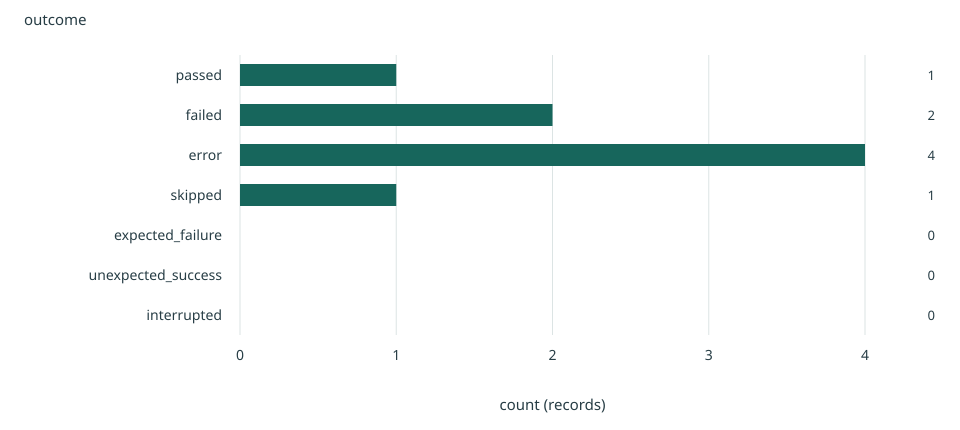

**Why:** Aligned bars make category magnitudes easy to compare; the value axis includes zero.

**Limits:** Observed test records only. Fixture/discovery records are identified separately. Timing is not a performance benchmark.

Source: [results.json](results.json) · `/datasets/outcomes`

| outcome | count |

| --- | --- |

| passed | 1 |

| failed | 2 |

| error | 4 |

| skipped | 1 |

| expected_failure | 0 |

| unexpected_success | 0 |

| interrupted | 0 |

## Outcomes by suite (minor suites explicitly grouped)

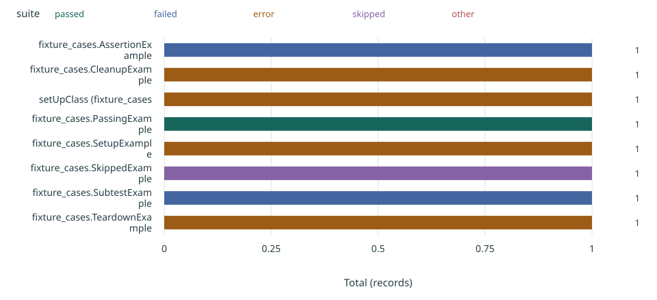

**Why:** Segments show absolute contributions to a total; middle segments are harder to compare across groups.

**Limits:** Observed test records only. Fixture/discovery records are identified separately. Timing is not a performance benchmark.

Source: [results.json](results.json) · `/datasets/suite-outcomes`

| suite | passed | failed | error | skipped | other |

| --- | --- | --- | --- | --- | --- |

| fixture_cases.AssertionExample | 0 | 1 | 0 | 0 | 0 |

| fixture_cases.CleanupExample | 0 | 0 | 1 | 0 | 0 |

| setUpClass (fixture_cases | 0 | 0 | 1 | 0 | 0 |

| fixture_cases.PassingExample | 1 | 0 | 0 | 0 | 0 |

| fixture_cases.SetupExample | 0 | 0 | 1 | 0 | 0 |

| fixture_cases.SkippedExample | 0 | 0 | 0 | 1 | 0 |

| fixture_cases.SubtestExample | 0 | 1 | 0 | 0 | 0 |

| fixture_cases.TeardownExample | 0 | 0 | 1 | 0 | 0 |

## Slowest cases — top 12; full inventory below

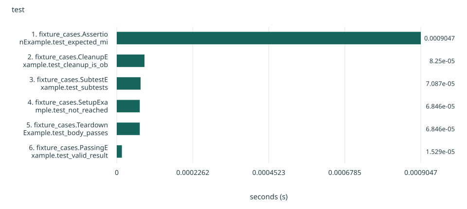

**Why:** Aligned bars make category magnitudes easy to compare; the value axis includes zero.

**Limits:** Observed test records only. Fixture/discovery records are identified separately. Timing is not a performance benchmark.

Source: [results.json](results.json) · `/datasets/slowest`

| test | seconds |

| --- | --- |

| 1. fixture_cases.AssertionExample.test_expected_mismatch | 0.0009046669999999979 |

| 2. fixture_cases.CleanupExample.test_cleanup_is_observed | 8.249999999999924e-05 |

| 3. fixture_cases.SubtestExample.test_subtests | 7.087499999999802e-05 |

| 4. fixture_cases.SetupExample.test_not_reached | 6.845899999999988e-05 |

| 5. fixture_cases.TeardownExample.test_body_passes | 6.845899999999988e-05 |

| 6. fixture_cases.PassingExample.test_valid_result | 1.5292000000000083e-05 |

## Distribution of observed case durations

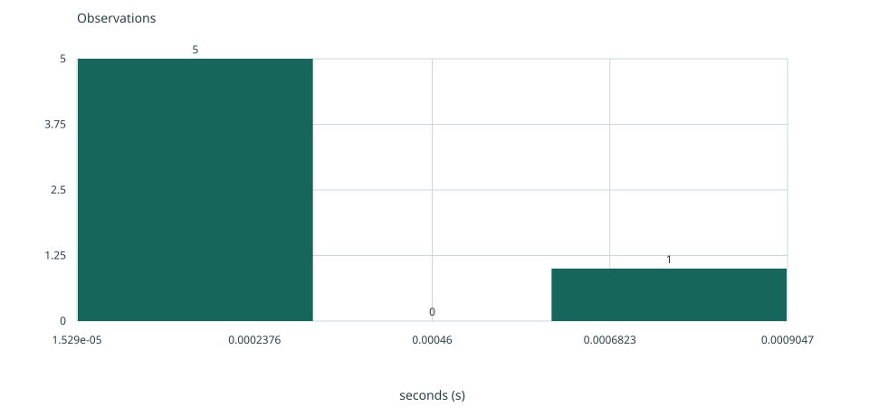

**Why:** Explicit bins show the distribution of raw observations; bin choice affects the apparent shape.

**Limits:** Observed test records only. Fixture/discovery records are identified separately. Timing is not a performance benchmark.

Source: [results.json](results.json) · `/datasets/duration-distribution`

| seconds |

| --- |

| 0.0009046669999999979 |

| 8.249999999999924e-05 |

| 1.5292000000000083e-05 |

| 6.845899999999988e-05 |

| 7.087499999999802e-05 |

| 6.845899999999988e-05 |

## Fraction of cases completed within each duration

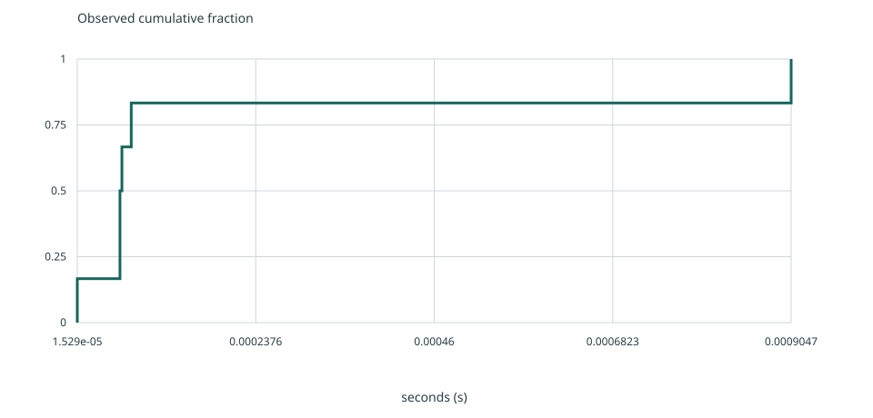

**Why:** The empirical cumulative distribution shows the observed fraction at or below each value without selecting histogram bins.

**Limits:** Observed test records only. Fixture/discovery records are identified separately. Timing is not a performance benchmark.

Source: [results.json](results.json) · `/datasets/duration-ecdf`

| seconds |

| --- |

| 0.0009046669999999979 |

| 8.249999999999924e-05 |

| 1.5292000000000083e-05 |

| 6.845899999999988e-05 |

| 7.087499999999802e-05 |

| 6.845899999999988e-05 |

## Duration spread across cases within each suite

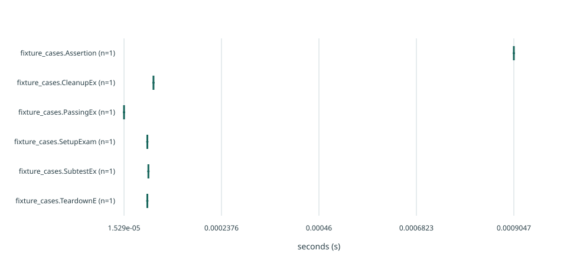

**Why:** Boxes summarize raw sample distributions using linear-interpolated quartiles and Tukey 1.5-IQR whiskers; dots show outliers, not confidence intervals.

**Limits:** Observed test records only. Fixture/discovery records are identified separately. Timing is not a performance benchmark.

Source: [results.json](results.json) · `/datasets/suite-spread`

| suite | seconds |

| --- | --- |

| fixture_cases.AssertionExample | 0.0009046669999999979 |

| fixture_cases.CleanupExample | 8.249999999999924e-05 |

| fixture_cases.PassingExample | 1.5292000000000083e-05 |

| fixture_cases.SetupExample | 6.845899999999988e-05 |

| fixture_cases.SubtestExample | 7.087499999999802e-05 |

| fixture_cases.TeardownExample | 6.845899999999988e-05 |

## Observed time by lifecycle stage

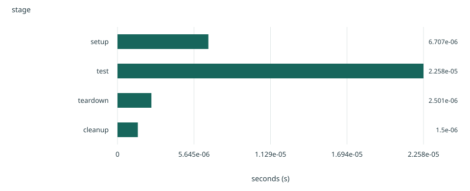

**Why:** Aligned bars make category magnitudes easy to compare; the value axis includes zero.

**Limits:** Observed test records only. Fixture/discovery records are identified separately. Timing is not a performance benchmark.

Source: [results.json](results.json) · `/datasets/stage-time`

| stage | seconds |

| --- | --- |

| setup | 6.707000000001628e-06 |

| test | 2.258199999999322e-05 |

| teardown | 2.500999999988096e-06 |

| cleanup | 1.5000000000015001e-06 |

## Failure events by observed stage (including unknown)

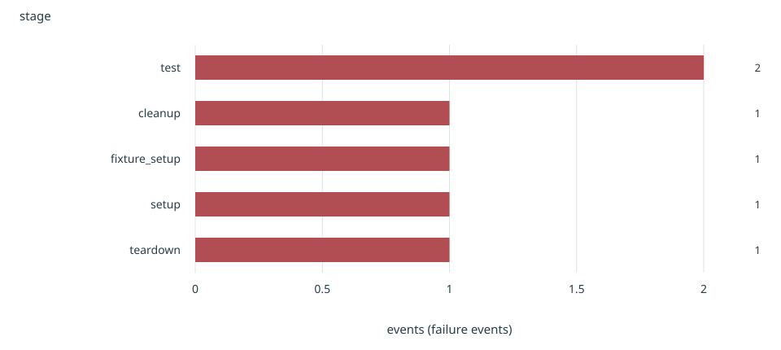

**Why:** Aligned bars make category magnitudes easy to compare; the value axis includes zero.

**Limits:** Observed test records only. Fixture/discovery records are identified separately. Timing is not a performance benchmark.

Source: [results.json](results.json) · `/datasets/failure-stages`

| stage | events |

| --- | --- |

| test | 2 |

| cleanup | 1 |

| fixture_setup | 1 |

| setup | 1 |

| teardown | 1 |

## Failure events by suite and stage

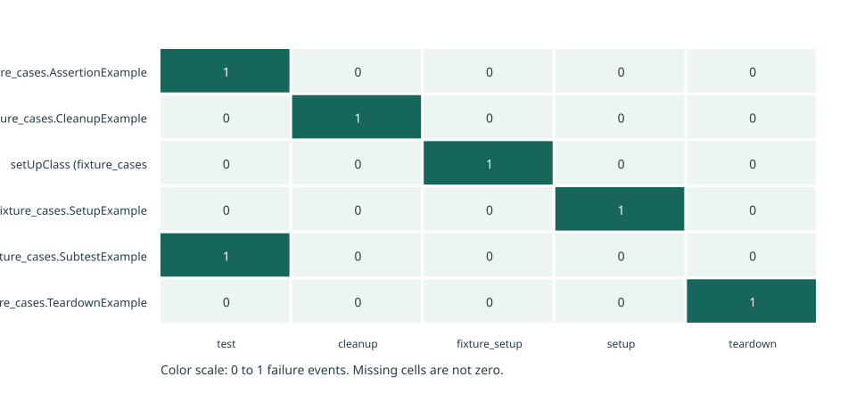

**Why:** Cell color reveals patterns across two categories; use the values and table for exact comparisons.

**Limits:** Observed test records only. Fixture/discovery records are identified separately. Timing is not a performance benchmark.

Source: [results.json](results.json) · `/datasets/failure-map`

| stage | suite | failures |

| --- | --- | --- |

| test | fixture_cases.AssertionExample | 1 |

| cleanup | fixture_cases.AssertionExample | 0 |

| fixture_setup | fixture_cases.AssertionExample | 0 |

| setup | fixture_cases.AssertionExample | 0 |

| teardown | fixture_cases.AssertionExample | 0 |

| test | fixture_cases.CleanupExample | 0 |

| cleanup | fixture_cases.CleanupExample | 1 |

| fixture_setup | fixture_cases.CleanupExample | 0 |

| setup | fixture_cases.CleanupExample | 0 |

| teardown | fixture_cases.CleanupExample | 0 |

| test | setUpClass (fixture_cases | 0 |

| cleanup | setUpClass (fixture_cases | 0 |

| fixture_setup | setUpClass (fixture_cases | 1 |

| setup | setUpClass (fixture_cases | 0 |

| teardown | setUpClass (fixture_cases | 0 |

| test | fixture_cases.SetupExample | 0 |

| cleanup | fixture_cases.SetupExample | 0 |

| fixture_setup | fixture_cases.SetupExample | 0 |

| setup | fixture_cases.SetupExample | 1 |

| teardown | fixture_cases.SetupExample | 0 |

| test | fixture_cases.SubtestExample | 1 |

| cleanup | fixture_cases.SubtestExample | 0 |

| fixture_setup | fixture_cases.SubtestExample | 0 |

| setup | fixture_cases.SubtestExample | 0 |

| teardown | fixture_cases.SubtestExample | 0 |

| test | fixture_cases.TeardownExample | 0 |

| cleanup | fixture_cases.TeardownExample | 0 |

| fixture_setup | fixture_cases.TeardownExample | 0 |

| setup | fixture_cases.TeardownExample | 0 |

| teardown | fixture_cases.TeardownExample | 1 |

## Failure workflows

First 20 failed-record workflows; all records and tracebacks remain below.

### fixture_cases.AssertionExample.test_expected_mismatch

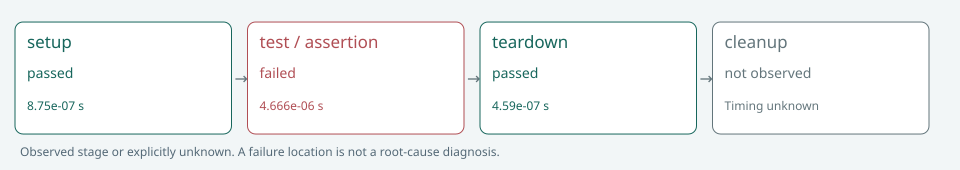

### fixture_cases.CleanupExample.test_cleanup_is_observed

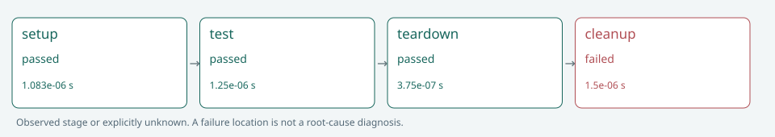

### setUpClass (fixture_cases.FixtureExample)

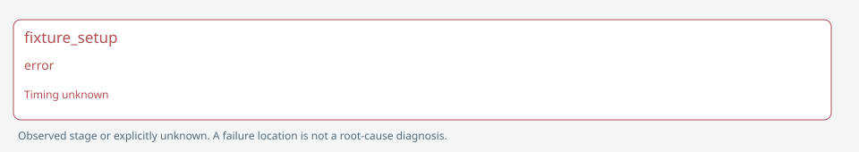

### fixture_cases.SetupExample.test_not_reached

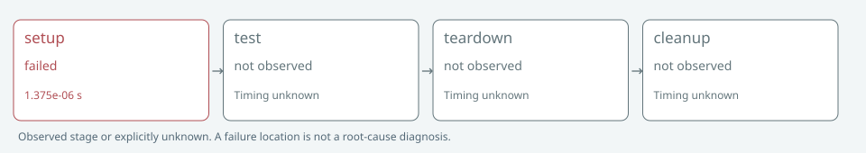

### fixture_cases.SubtestExample.test_subtests

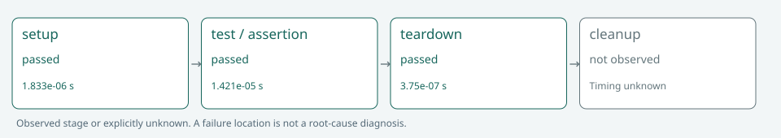

### fixture_cases.TeardownExample.test_body_passes

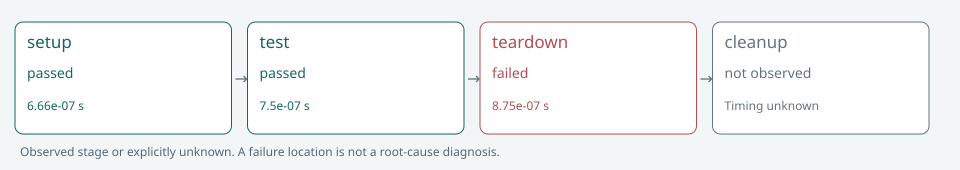

## Full inventory and tracebacks

### fixture_cases.AssertionExample.test_expected_mismatch

Outcome: failed · Kind: test · Duration: 0.0009046669999999979 s

Stage: test · 4 != 5 : Intentional assertion fixture

Traceback

<pre>Traceback (most recent call last):
  File &quot;/Library/Developer/CommandLineTools/Library/Frameworks/Python3.framework/Versions/3.9/lib/python3.9/unittest/case.py&quot;, line 59, in testPartExecutor
    yield
  File &quot;/Library/Developer/CommandLineTools/Library/Frameworks/Python3.framework/Versions/3.9/lib/python3.9/unittest/case.py&quot;, line 593, in run
    self._callTestMethod(testMethod)
  File &quot;/Users/up-mac/wokrspace/mind/skill-project-docs/scripts/test_results.py&quot;, line 106, in wrapped
    value=_method(*args,**kwargs)
  File &quot;/Library/Developer/CommandLineTools/Library/Frameworks/Python3.framework/Versions/3.9/lib/python3.9/unittest/case.py&quot;, line 550, in _callTestMethod
    method()
  File &quot;/Users/up-mac/wokrspace/mind/skill-project-docs/examples/test-report-fixture/fixture_cases.py&quot;, line 13, in test_expected_mismatch
    def test_expected_mismatch(self):self.assertEqual(2+2,5,&#x27;Intentional assertion fixture&#x27;)
  File &quot;/Library/Developer/CommandLineTools/Library/Frameworks/Python3.framework/Versions/3.9/lib/python3.9/unittest/case.py&quot;, line 831, in assertEqual
    assertion_func(first, second, msg=msg)
  File &quot;/Library/Developer/CommandLineTools/Library/Frameworks/Python3.framework/Versions/3.9/lib/python3.9/unittest/case.py&quot;, line 824, in _baseAssertEqual
    raise self.failureException(msg)
AssertionError: 4 != 5 : Intentional assertion fixture
</pre>

### fixture_cases.CleanupExample.test_cleanup_is_observed

Outcome: error · Kind: test · Duration: 8.249999999999924e-05 s

Stage: cleanup · Intentional cleanup fixture

Traceback

<pre>Traceback (most recent call last):
  File &quot;/Library/Developer/CommandLineTools/Library/Frameworks/Python3.framework/Versions/3.9/lib/python3.9/unittest/case.py&quot;, line 59, in testPartExecutor
    yield
  File &quot;/Library/Developer/CommandLineTools/Library/Frameworks/Python3.framework/Versions/3.9/lib/python3.9/unittest/case.py&quot;, line 634, in doCleanups
    self._callCleanup(function, *args, **kwargs)
  File &quot;/Users/up-mac/wokrspace/mind/skill-project-docs/scripts/test_results.py&quot;, line 106, in wrapped
    value=_method(*args,**kwargs)
  File &quot;/Library/Developer/CommandLineTools/Library/Frameworks/Python3.framework/Versions/3.9/lib/python3.9/unittest/case.py&quot;, line 556, in _callCleanup
    function(*args, **kwargs)
  File &quot;/Users/up-mac/wokrspace/mind/skill-project-docs/examples/test-report-fixture/fixture_cases.py&quot;, line 28, in cleanup_failure
    def cleanup_failure(self):raise RuntimeError(&#x27;Intentional cleanup fixture&#x27;)
RuntimeError: Intentional cleanup fixture
</pre>

### setUpClass (fixture_cases.FixtureExample)

Outcome: error · Kind: fixture · Duration: unknown s

Stage: fixture_setup · Intentional class fixture failure

Traceback

<pre>Traceback (most recent call last):
  File &quot;/Library/Developer/CommandLineTools/Library/Frameworks/Python3.framework/Versions/3.9/lib/python3.9/unittest/suite.py&quot;, line 163, in _handleClassSetUp
    setUpClass()
  File &quot;/Users/up-mac/wokrspace/mind/skill-project-docs/examples/test-report-fixture/fixture_cases.py&quot;, line 33, in setUpClass
    def setUpClass(cls):raise RuntimeError(&#x27;Intentional class fixture failure&#x27;)
RuntimeError: Intentional class fixture failure
</pre>

### fixture_cases.PassingExample.test_valid_result

Outcome: passed · Kind: test · Duration: 1.5292000000000083e-05 s

### fixture_cases.SetupExample.test_not_reached

Outcome: error · Kind: test · Duration: 6.845899999999988e-05 s

Stage: setup · Intentional setup fixture

Traceback

<pre>Traceback (most recent call last):
  File &quot;/Library/Developer/CommandLineTools/Library/Frameworks/Python3.framework/Versions/3.9/lib/python3.9/unittest/case.py&quot;, line 59, in testPartExecutor
    yield
  File &quot;/Library/Developer/CommandLineTools/Library/Frameworks/Python3.framework/Versions/3.9/lib/python3.9/unittest/case.py&quot;, line 589, in run
    self._callSetUp()
  File &quot;/Users/up-mac/wokrspace/mind/skill-project-docs/scripts/test_results.py&quot;, line 106, in wrapped
    value=_method(*args,**kwargs)
  File &quot;/Library/Developer/CommandLineTools/Library/Frameworks/Python3.framework/Versions/3.9/lib/python3.9/unittest/case.py&quot;, line 547, in _callSetUp
    self.setUp()
  File &quot;/Users/up-mac/wokrspace/mind/skill-project-docs/examples/test-report-fixture/fixture_cases.py&quot;, line 17, in setUp
    def setUp(self):raise RuntimeError(&#x27;Intentional setup fixture&#x27;)
RuntimeError: Intentional setup fixture
</pre>

### fixture_cases.SkippedExample.test_skipped

Outcome: skipped · Kind: test · Duration: 5.041999999996771e-06 s

Skip: Intentional skipped fixture

### fixture_cases.SubtestExample.test_subtests

Outcome: failed · Kind: test · Duration: 7.087499999999802e-05 s

Stage: test · 1 != 0 : Intentional subtest fixture

Traceback

<pre>Traceback (most recent call last):
  File &quot;/Library/Developer/CommandLineTools/Library/Frameworks/Python3.framework/Versions/3.9/lib/python3.9/unittest/case.py&quot;, line 59, in testPartExecutor
    yield
  File &quot;/Library/Developer/CommandLineTools/Library/Frameworks/Python3.framework/Versions/3.9/lib/python3.9/unittest/case.py&quot;, line 499, in subTest
    yield
  File &quot;/Users/up-mac/wokrspace/mind/skill-project-docs/examples/test-report-fixture/fixture_cases.py&quot;, line 45, in test_subtests
    with self.subTest(value=value):self.assertEqual(value,0,&#x27;Intentional subtest fixture&#x27;)
  File &quot;/Library/Developer/CommandLineTools/Library/Frameworks/Python3.framework/Versions/3.9/lib/python3.9/unittest/case.py&quot;, line 831, in assertEqual
    assertion_func(first, second, msg=msg)
  File &quot;/Library/Developer/CommandLineTools/Library/Frameworks/Python3.framework/Versions/3.9/lib/python3.9/unittest/case.py&quot;, line 824, in _baseAssertEqual
    raise self.failureException(msg)
AssertionError: 1 != 0 : Intentional subtest fixture
</pre>

### fixture_cases.TeardownExample.test_body_passes

Outcome: error · Kind: test · Duration: 6.845899999999988e-05 s

Stage: teardown · Intentional teardown fixture

Traceback

<pre>Traceback (most recent call last):
  File &quot;/Library/Developer/CommandLineTools/Library/Frameworks/Python3.framework/Versions/3.9/lib/python3.9/unittest/case.py&quot;, line 59, in testPartExecutor
    yield
  File &quot;/Library/Developer/CommandLineTools/Library/Frameworks/Python3.framework/Versions/3.9/lib/python3.9/unittest/case.py&quot;, line 596, in run
    self._callTearDown()
  File &quot;/Users/up-mac/wokrspace/mind/skill-project-docs/scripts/test_results.py&quot;, line 106, in wrapped
    value=_method(*args,**kwargs)
  File &quot;/Library/Developer/CommandLineTools/Library/Frameworks/Python3.framework/Versions/3.9/lib/python3.9/unittest/case.py&quot;, line 553, in _callTearDown
    self.tearDown()
  File &quot;/Users/up-mac/wokrspace/mind/skill-project-docs/examples/test-report-fixture/fixture_cases.py&quot;, line 23, in tearDown
    def tearDown(self):raise RuntimeError(&#x27;Intentional teardown fixture&#x27;)
RuntimeError: Intentional teardown fixture
</pre>

## Limits

Subtest durations are unknown; parent-case timing is observed.

Fixture stages are identified only from actual traceback function names; fixture durations are unknown.

History uses at most 30 earlier matching contexts; no one-run flakiness conclusion.

Coverage and branch coverage are unavailable unless measured by a supplied coverage file.

Report generation does not alter task status or diagnose root cause.

[Raw log](runner.log)
